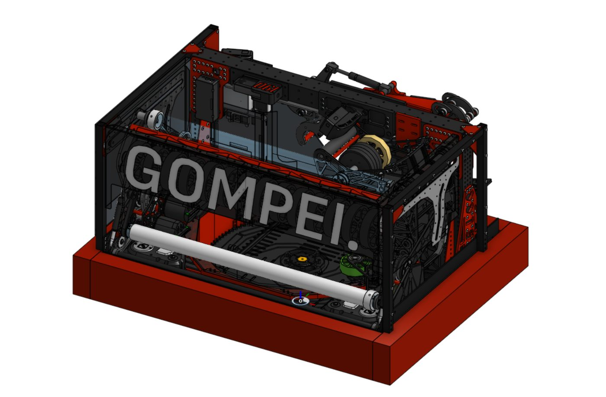
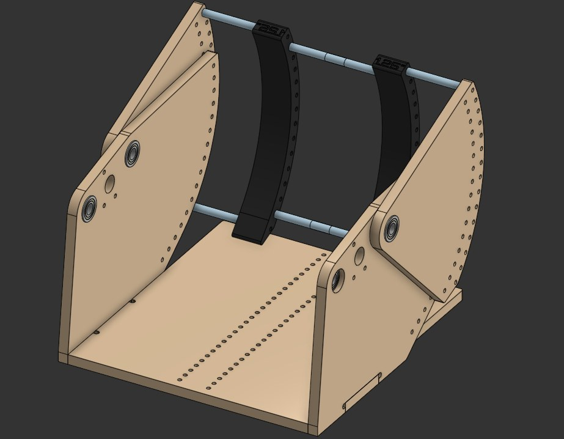
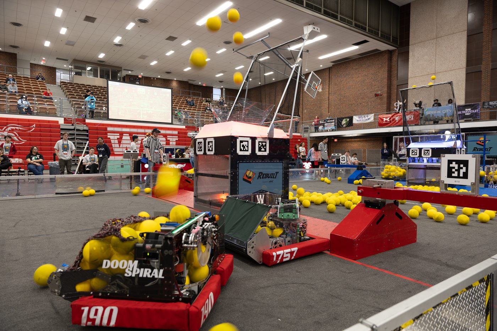
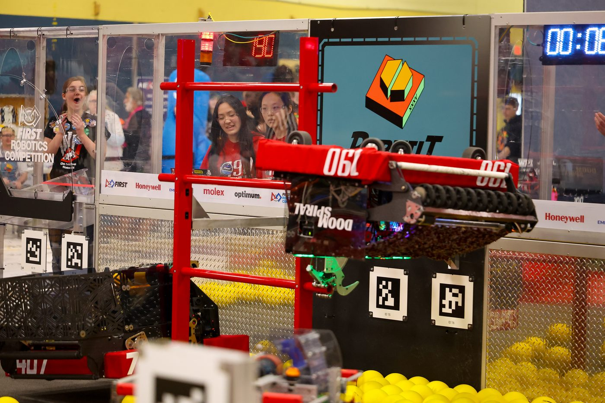

  

    <h1 class="subtitle">FRC Team 190</h1>
    
<em>2026 season</em>

    
Our first robot for the 2026 FRC game, "REBUILT."

    
Its primary goals were to shoot yellow foam "Fuel" balls into an alliance Hub at the center of our side of the field, and to climb the rungs of a ladder-shaped Tower at the end of the match. The robot advanced far into the district championship and qualified the team for the world championships, where it also performed well. My main contributions were to the shooter subsystem. The robot was originally designed in Onshape.

    

      <a href="https://frc190.onshape.com/documents/b452dd5a31bf95c6384826fb/v/9a4c2c25c61eed3915122777/e/934f62b4a3bd58acfff00615?configuration=default&renderMode=0&uiState=6a18f20ed4512fd9e5239b0f">CAD</a>
      &middot;
      <a href="https://www.thebluealliance.com/team/190/2026">TBA</a>
    

  

  

    <figure>
      
      <figcaption>Doomspiral full robot CAD</figcaption>
    </figure>
  

  

    <h2 id="prototyping-the-shooter">Prototyping the shooter</h2>
    
Before settling on the V1 shooter, we tested it on prototypes. Prototype 1 was built before the season started. The custom prototype is the one we made ourselves, described below.

  

  

    

      <figure style="--ratio:1.7778">
        <video class="loop" muted loop playsinline controls preload="none" poster="../img/frc/doomspiral/prototype-1.jpg" aria-label="Prototype 1, built before the season started">
          <source src="../img/frc/doomspiral/prototype-1.mp4" type="video/mp4">
        </video>
        <figcaption>Prototype 1, built before the season started</figcaption>
      </figure>
      <figure style="--ratio:1.7778">
        <video class="loop" muted loop playsinline controls preload="none" poster="../img/frc/doomspiral/mass-prototype-1.jpg" aria-label="Mass prototype 1">
          <source src="../img/frc/doomspiral/mass-prototype-1.mp4" type="video/mp4">
        </video>
        <figcaption>Mass prototype 1</figcaption>
      </figure>
    

  

  

    <h2 id="custom-prototype">Custom prototype</h2>
    
The custom prototype had three adjustments:

    <ul>
      <li>An adjustable hood angle</li>
      <li>An optional divider</li>
      <li>Adjustable compression, set by changing the back piece</li>
    </ul>
    
It was built mainly from CNC-cut plywood and 3D printed parts so we could iterate quickly. We used it to inform the amount of compression and the hood angle the real version needed.

  

  

    

      <figure style="--ratio:1.0983">
        
        <figcaption>Custom prototype CAD, with the divider</figcaption>
      </figure>
      <figure style="--ratio:1.2855">
        
        <figcaption>Custom prototype CAD, without the divider</figcaption>
      </figure>
    

    

      <figure style="--ratio:1.7778">
        <video class="loop" muted loop playsinline controls preload="none" poster="../img/frc/doomspiral/custom-prototype-1.jpg" aria-label="Custom prototype shooting">
          <source src="../img/frc/doomspiral/custom-prototype-1.mp4" type="video/mp4">
        </video>
        <figcaption>Custom prototype shooting</figcaption>
      </figure>
      <figure style="--ratio:1.7778">
        <video class="loop" muted loop playsinline controls preload="none" poster="../img/frc/doomspiral/custom-prototype-2.jpg" aria-label="Custom prototype shooting, wider view">
          <source src="../img/frc/doomspiral/custom-prototype-2.mp4" type="video/mp4">
        </video>
        <figcaption>Custom prototype shooting, wider view</figcaption>
      </figure>
    

  

  

    <h2>Early hood concept</h2>
    
An early concept for the hood, shown in cartoon-style CAD.

  

  

    

      <figure style="--ratio:1.5246">
        
        <figcaption>Early hood concept</figcaption>
      </figure>
      <figure style="--ratio:1.714">
        
        <figcaption>Early hood concept, second view</figcaption>
      </figure>
    

  

  

    <h2>The real shooter</h2>
    
The finished V1 shooter running on Doomspiral, built with the compression and hood angle worked out on the prototype.

  

  

    <figure>
      <video class="loop" muted loop playsinline controls preload="none" style="--ratio:1.7778" poster="../img/frc/doomspiral/real-shooter.jpg" aria-label="Doomspiral shooting">
        <source src="../img/frc/doomspiral/real-shooter.mp4" type="video/mp4">
      </video>
      <figcaption>Doomspiral shooting</figcaption>
    </figure>
  

  <figure>
    
    <figcaption>Doomspiral hanging from the Tower rungs</figcaption>
  </figure>
  <figure>
    
    <figcaption>Doomspiral shooting during a match</figcaption>
  </figure>
  <figure>
    
    <figcaption>Isometric CAD view of the Doomspiral shooter assembly</figcaption>
  </figure>
  <figure>
    
    <figcaption>Doomspiral hanging from the climb bar at the end of a match</figcaption>
  </figure>

