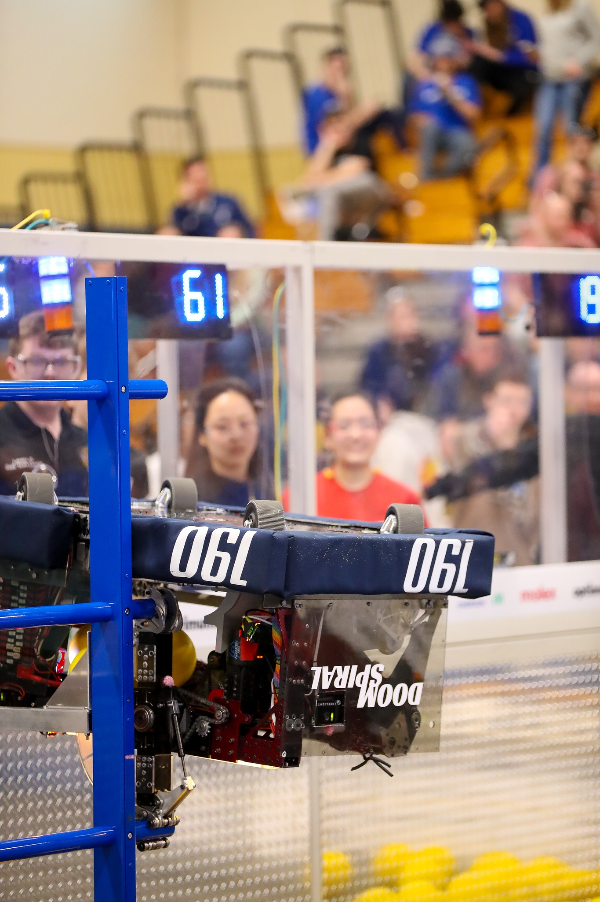
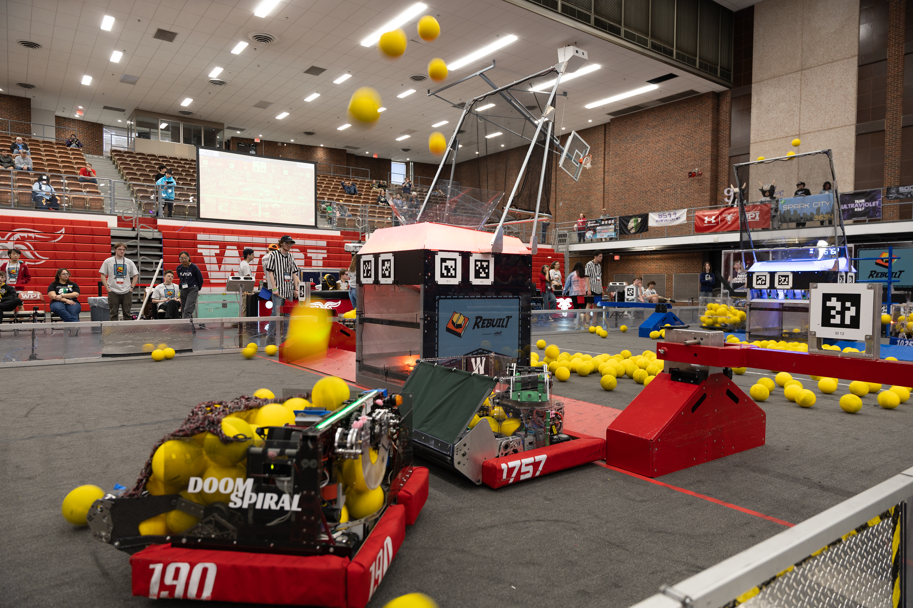
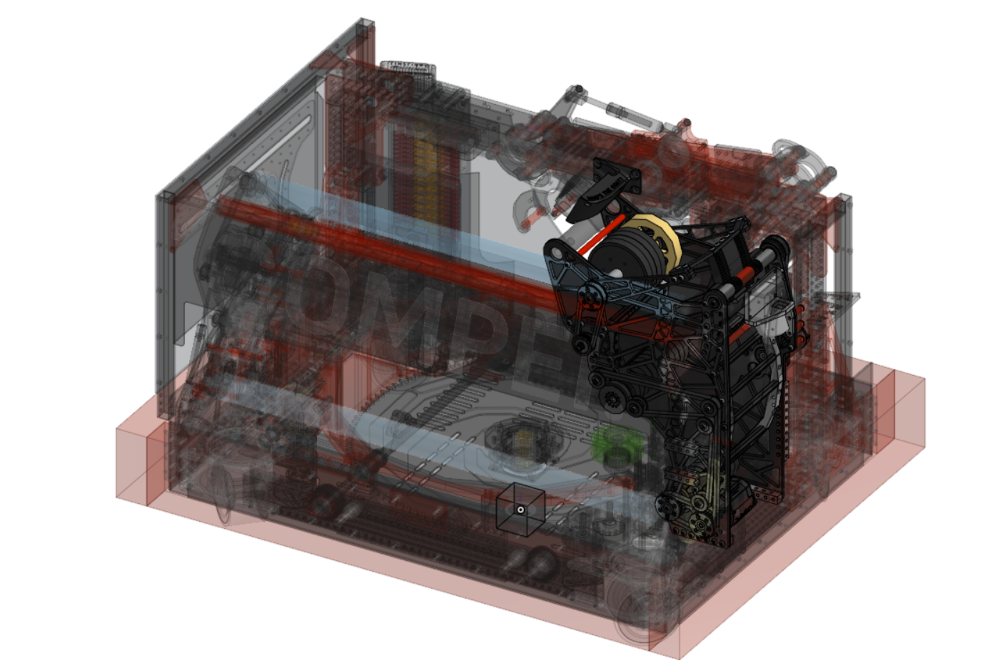
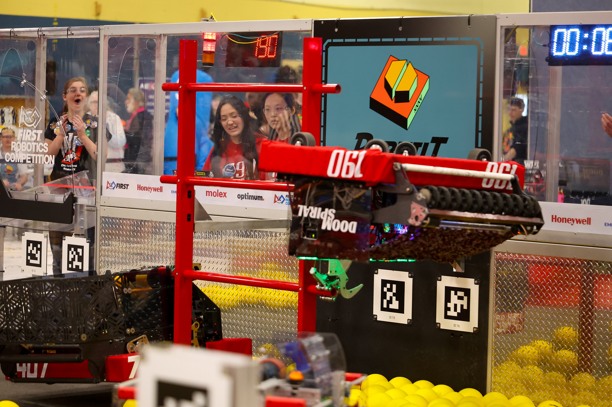

  

    <h1 class="subtitle">FRC Team 190</h1>
    
<em>2026 season</em>

    
Our first robot for the 2026 FRC game, "REBUILT."

    
Its primary goals were to shoot yellow foam "Fuel" balls into an alliance Hub at the center of our side of the field, and to climb the rungs of a ladder-shaped Tower at the end of the match. The robot advanced far into the district championship and qualified the team for the world championships, where it also performed well. My main contributions were to the shooter subsystem. The robot was originally designed in Onshape.

    

      <a href="https://frc190.onshape.com/documents/b452dd5a31bf95c6384826fb/v/9a4c2c25c61eed3915122777/e/934f62b4a3bd58acfff00615?configuration=default&renderMode=0&uiState=6a18f20ed4512fd9e5239b0f">CAD</a>
      &middot;
      <a href="https://www.thebluealliance.com/team/190/2026">TBA</a>
    

  

  

    <figure>
      
      <figcaption>Doomspiral full robot CAD</figcaption>
    </figure>
  

  <figure>
    
    <figcaption>Doomspiral hanging from the Tower rungs</figcaption>
  </figure>
  <figure>
    
    <figcaption>Doomspiral shooting during a match</figcaption>
  </figure>
  <figure>
    
    <figcaption>Isometric CAD view of the Doomspiral shooter assembly</figcaption>
  </figure>
  <figure>
    
    <figcaption>Doomspiral hanging from the climb bar at the end of a match</figcaption>
  </figure>

