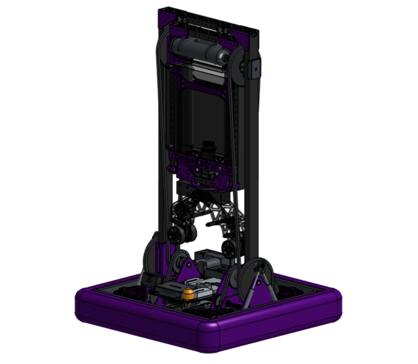
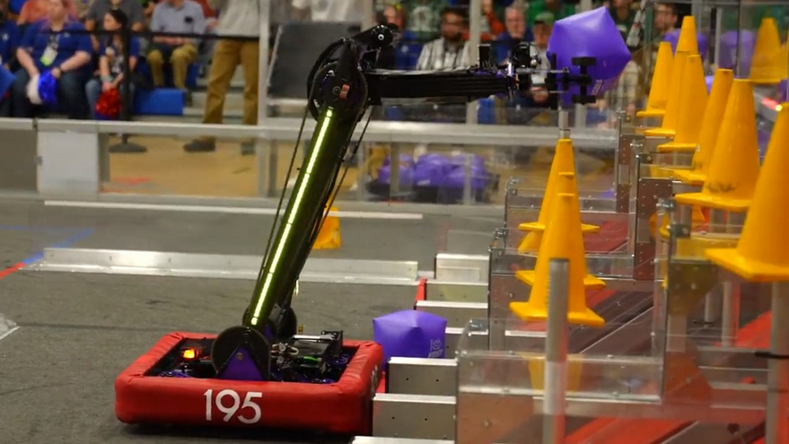
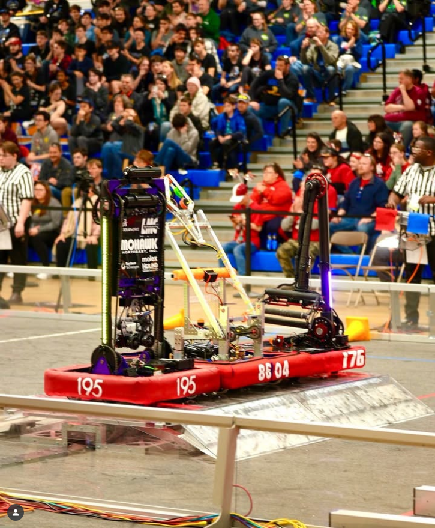

  

    <h1 class="subtitle">FRC Team 195</h1>
    
<em>2023 season</em>

    
This robot was created for the 2023 FRC game, "Charged Up."

    
Its primary objective was to score cones on poles and cubes on shelves, then balance on a platform with its alliance partners. It competed at a very high level and went far into its division at the world championships. The robot was originally designed in SOLIDWORKS.

    
<a href="https://www.thebluealliance.com/team/195/2023">TBA</a>

  

  

    <figure>
      
      <figcaption>KnightTime 2023 robot CAD</figcaption>
    </figure>
  

  <figure>
    
    <figcaption>KnightTime 2023 scoring a cone</figcaption>
  </figure>
  <figure>
    
    <figcaption>KnightTime 2023 balancing on the charge station</figcaption>
  </figure>
  <figure>
    
    <figcaption>KnightTime 2023 in the pits</figcaption>
  </figure>

