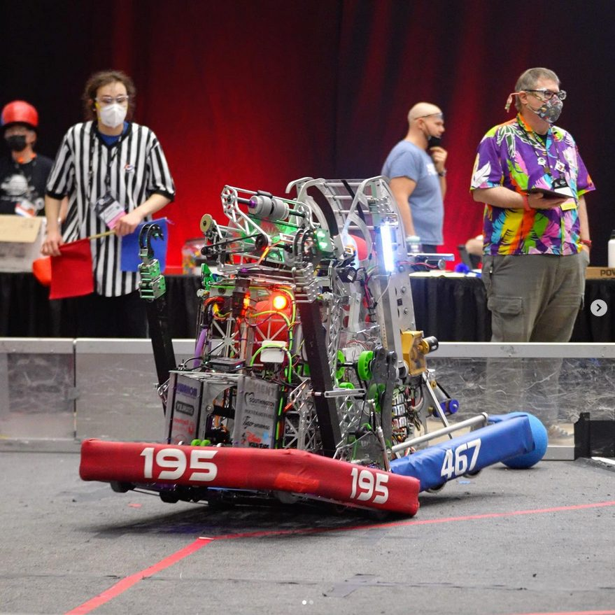
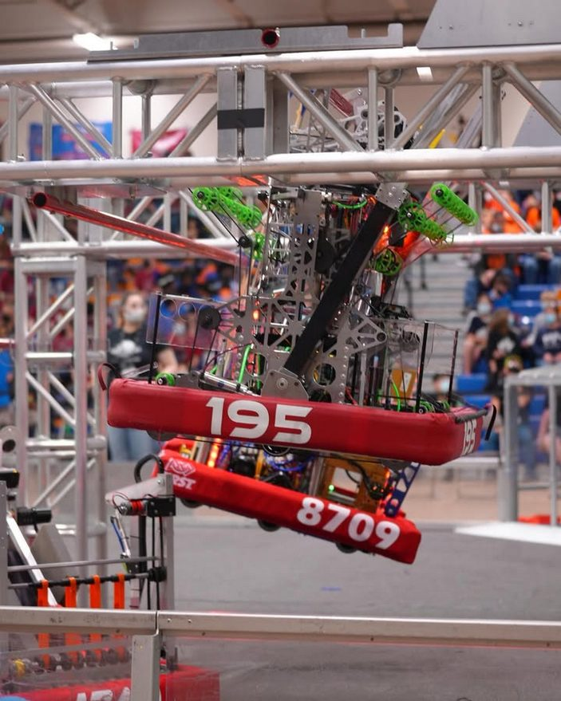

  

    <h1 class="subtitle">FRC Team 195</h1>
    
<em>2022 season</em>

    
Designed for the 2022 FRC game, "Rapid React," this robot's main objective was to score large tennis balls into a central goal and climb a monkey bar-like structure.

    
It was originally designed in SOLIDWORKS.

    
<a href="https://www.thebluealliance.com/team/195/2022">TBA</a>

  

  

    <figure>
      
      <figcaption>Nightwatch 2022 during a match</figcaption>
    </figure>
    <figure>
      
      <figcaption>Nightwatch 2022 climbing the hangar bars</figcaption>
    </figure>
  

