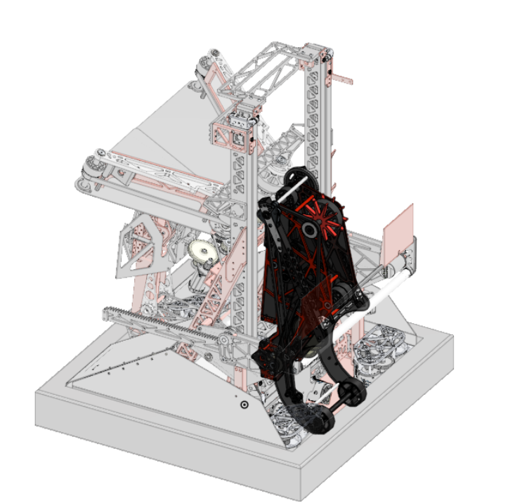
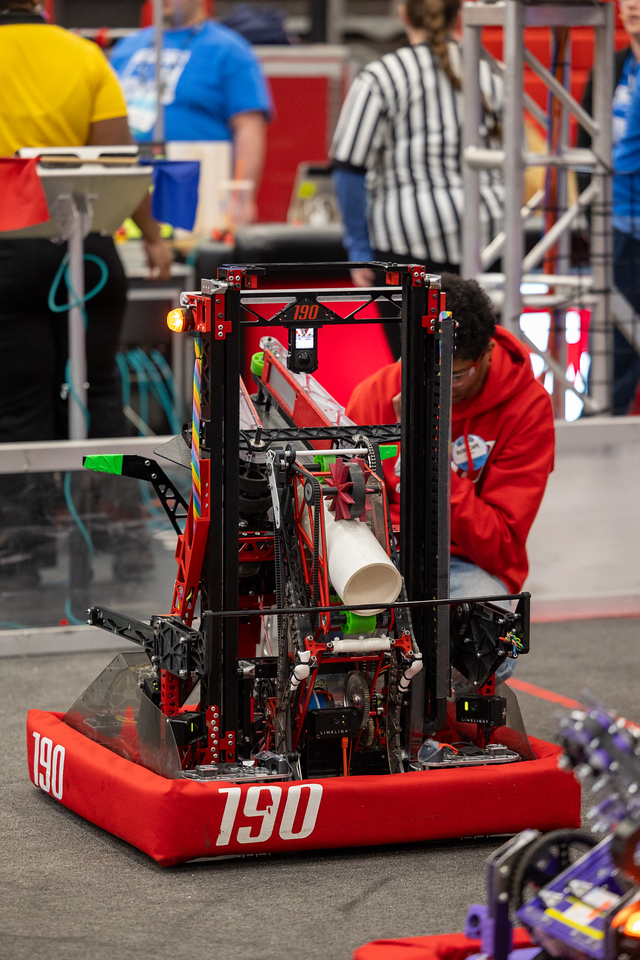

  

    <h1 class="subtitle">FRC Team 190</h1>
    
<em>2025 season</em>

    
This robot was designed for the 2025 FRC game, "Reefscape."

    
Its primary goals were to score PVC pipes on elevated posts, launch large kickballs into a net approximately 8 feet high, and climb onto a rectangular "cage." The robot performed at a very high level, advancing far into its division at the world championships. My main contributions were to the scoring and claw subsystem. The robot was originally designed in Onshape.

    

      <a href="https://frc190.onshape.com/documents/b6c840749d995b1ac1b29215/w/5eb3125bc19878c175f07023/e/271cc80064eb69c77815f945?configuration=default&renderMode=0&uiState=68ba3b2a2b577176a1982abb">CAD</a>
      &middot;
      <a href="https://www.thebluealliance.com/team/190/2025">TBA</a>
    

  

  

    <figure>
      
      <figcaption>Redundancy robot CAD</figcaption>
    </figure>
  

  <figure>
    
    <figcaption>Redundancy during a match</figcaption>
  </figure>
  <figure>
    
    <figcaption>Redundancy on the field before a match</figcaption>
  </figure>
  <figure>
    
    <figcaption>Redundancy scoring at the barge</figcaption>
  </figure>

