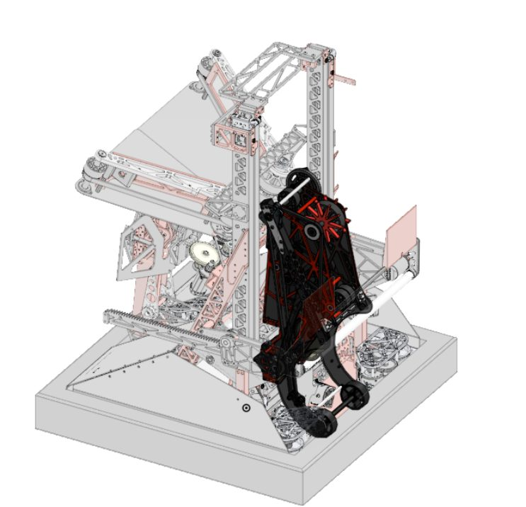
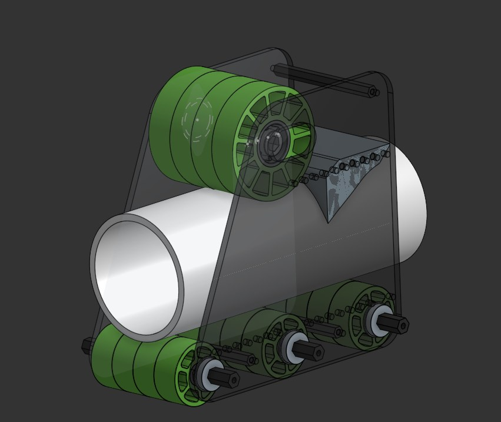
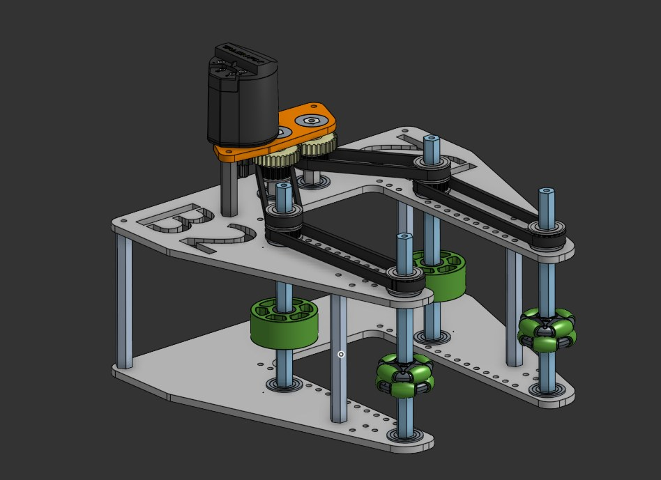
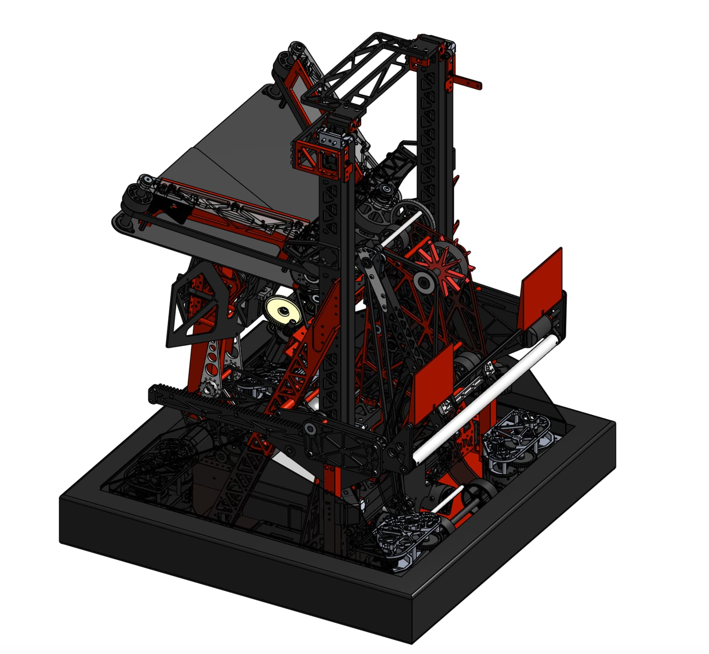
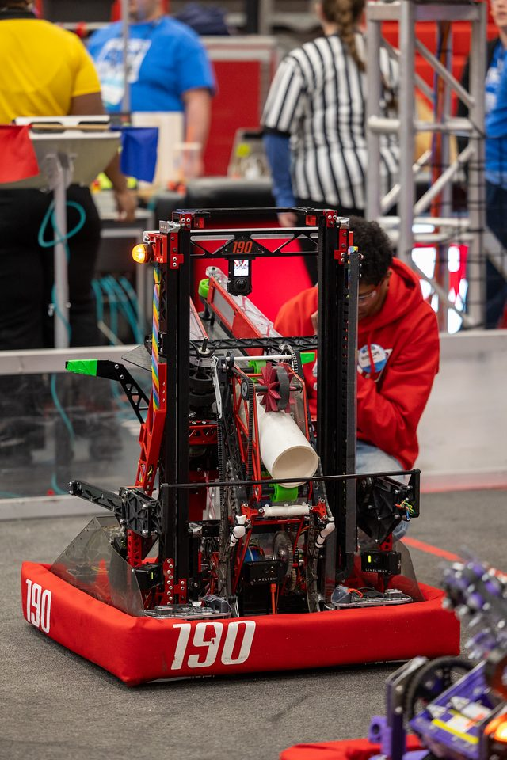
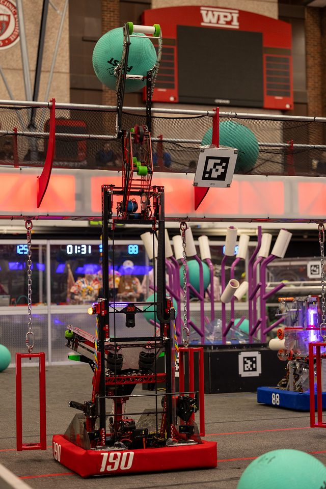

  

    <h1 class="subtitle">FRC Team 190</h1>
    
<em>2025 season</em>

    
This robot was designed for the 2025 FRC game, "Reefscape."

    
Its primary goals were to score PVC pipes on elevated posts, launch large kickballs into a net approximately 8 feet high, and climb onto a rectangular "cage." The robot performed at a very high level, advancing far into its division at the world championships. My main contributions were to the scoring and claw subsystem. The robot was originally designed in Onshape.

    

      <a href="https://frc190.onshape.com/documents/b6c840749d995b1ac1b29215/w/5eb3125bc19878c175f07023/e/271cc80064eb69c77815f945?configuration=default&renderMode=0&uiState=68ba3b2a2b577176a1982abb">CAD</a>
      &middot;
      <a href="https://www.thebluealliance.com/team/190/2025">TBA</a>
    

  

  

    <figure>
      
      <figcaption>Redundancy robot CAD</figcaption>
    </figure>
  

  

    <h2 id="end-effector">End effector</h2>
    
The goal of the end effector was to score on all four levels without adding another degree of freedom. The key was getting the coral to flip up onto the vertical L4 posts, and the position of the wheels is what let us tune that.

  

  

    <figure style="--ratio:1.9672">
      <video class="loop" muted loop playsinline controls preload="none" poster="../img/frc/redundancy/pov-l4.jpg" aria-label="Scoring on L4, from the robot's point of view">
        <source src="../img/frc/redundancy/pov-l4.mp4" type="video/mp4">
      </video>
      <figcaption>Scoring on L4, from the robot's point of view</figcaption>
    </figure>
  

  

    <h2 id="prototypes">Prototypes</h2>
    
We built two prototypes, one with the wheels vertical and one with the wheels horizontal, which we called the X-wing. Both had movable wheels, so we could adjust the wheel position and the compression.

  

  

    

      <figure style="--ratio:1.1869">
        
        <figcaption>Prototype with vertical wheels</figcaption>
      </figure>
      <figure style="--ratio:1.3759">
        
        <figcaption>X-wing prototype, with horizontal wheels</figcaption>
      </figure>
    

    

      <figure style="--ratio:1.7778">
        <video class="loop" muted loop playsinline controls preload="none" poster="../img/frc/redundancy/vertical-l4.jpg" aria-label="Vertical-wheel prototype scoring on an L4 post">
          <source src="../img/frc/redundancy/vertical-l4.mp4" type="video/mp4">
        </video>
        <figcaption>Vertical-wheel prototype scoring on an L4 post</figcaption>
      </figure>
      <figure style="--ratio:0.5625">
        <video class="loop" muted loop playsinline controls preload="none" poster="../img/frc/redundancy/xwing-l4.jpg" aria-label="X-wing prototype scoring on an L4 post">
          <source src="../img/frc/redundancy/xwing-l4.mp4" type="video/mp4">
        </video>
        <figcaption>X-wing prototype scoring on an L4 post</figcaption>
      </figure>
    

  

  

    <h2 id="scoring-on-l4">Scoring on L4</h2>
  

  

    

      <figure style="--ratio:0.5625">
        <video class="loop" muted loop playsinline controls preload="none" poster="../img/frc/redundancy/robot-l4.jpg" aria-label="Redundancy scoring on L4">
          <source src="../img/frc/redundancy/robot-l4.mp4" type="video/mp4">
        </video>
        <figcaption>Redundancy scoring on L4</figcaption>
      </figure>
      <figure style="--ratio:0.5625">
        <video class="loop" muted loop playsinline controls preload="none" poster="../img/frc/redundancy/robot-l4-2.jpg" aria-label="Redundancy scoring on L4, second view">
          <source src="../img/frc/redundancy/robot-l4-2.mp4" type="video/mp4">
        </video>
        <figcaption>Redundancy scoring on L4, second view</figcaption>
      </figure>
    

  

  <figure>
    
    <figcaption>Redundancy CAD, isometric view</figcaption>
  </figure>
  <figure>
    
    <figcaption>Redundancy on the field before a match</figcaption>
  </figure>
  <figure>
    
    <figcaption>Redundancy scoring at the barge</figcaption>
  </figure>

