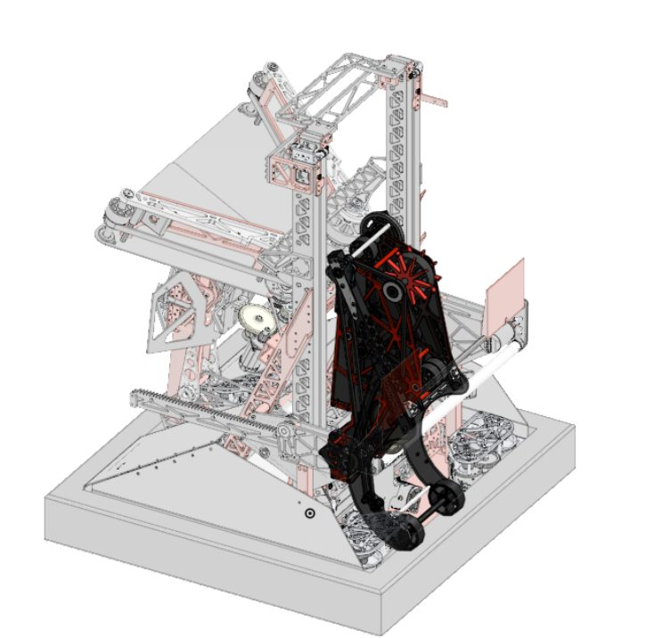
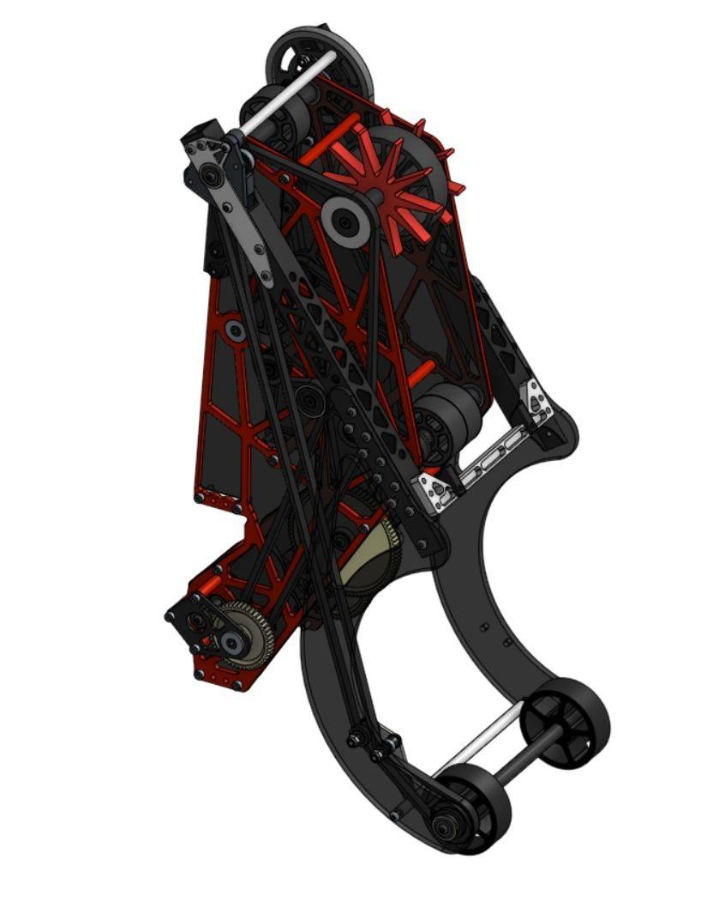
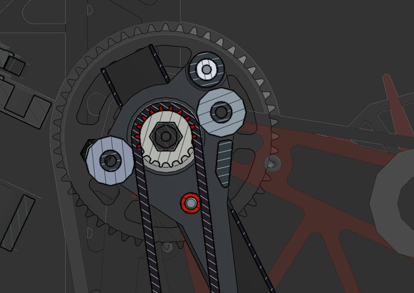
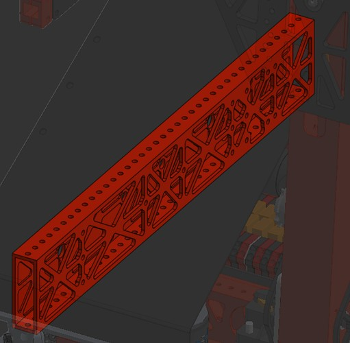
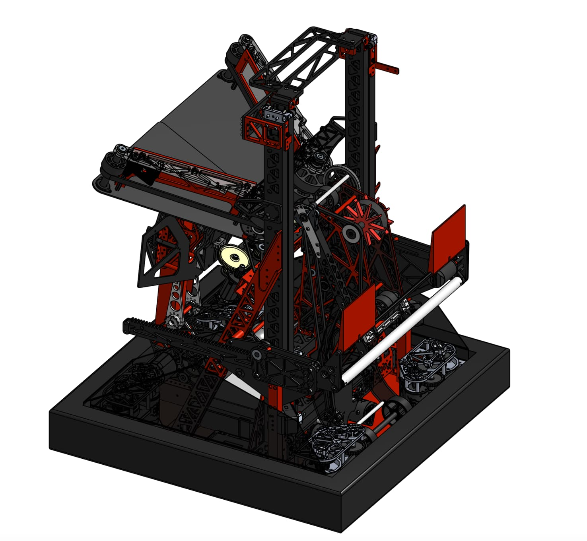
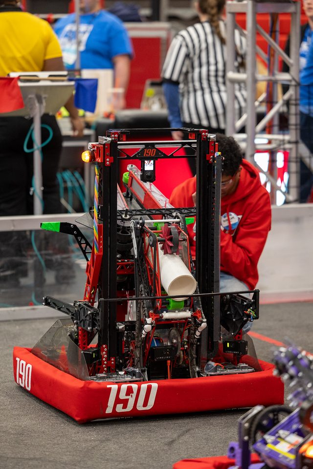
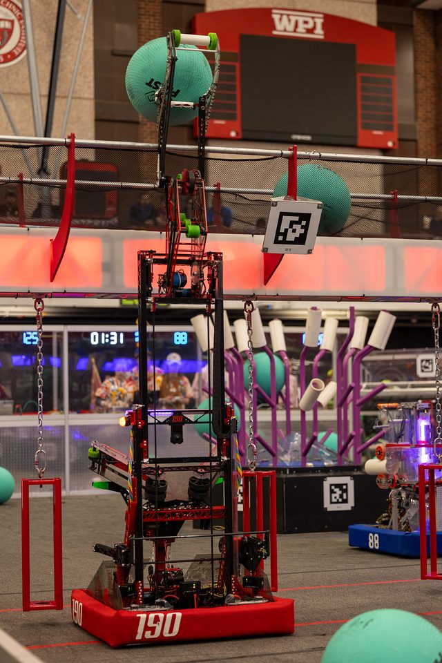

  

    <h1 class="subtitle">FRC Team 190</h1>
    
<em>2025 season</em>

    
This robot was designed for the 2025 FRC game, "Reefscape."

    
Its primary goals were to score PVC pipes on elevated posts, launch large kickballs into a net approximately 8 feet high, and climb onto a rectangular "cage." The robot performed at a very high level, advancing far into its division at the world championships. My main contributions were to the scoring and claw subsystem. The robot was originally designed in Onshape.

    
This is the second version of that season's robot. The first was <a href="frcStackup.html">Stackup</a>.

    
Its main goal was to excel at higher levels of play, using our machining capabilities. It was originally supposed to have more room to be different from Stackup, but time constraints meant we settled on an upgraded version of it.

    

      <a href="https://frc190.onshape.com/documents/b6c840749d995b1ac1b29215/w/5eb3125bc19878c175f07023/e/271cc80064eb69c77815f945?configuration=default&renderMode=0&uiState=68ba3b2a2b577176a1982abb">CAD</a>
      &middot;
      <a href="https://www.thebluealliance.com/team/190/2025">TBA</a>
      &middot;
      <a href="https://www.chiefdelphi.com/t/190-cad-release/503355">Chief Delphi</a>
    

  

  

    <figure>
      
      <figcaption>Redundancy robot CAD</figcaption>
    </figure>
  

  

    <h2 id="end-effector">End effector</h2>
    
For this version we added the algae claw to the end effector and kept a similar structure for coral. The end effector now also had to manipulate algae into the barge.

    
We also added star wheels to the coral outtake. Without them we sometimes didn&rsquo;t get the flip-up motion we wanted, especially when the robot was slightly too low. The star wheels grab the lip of the coral and flip it onto L4.

    
The coral design, and the prototyping behind it, are on the <a href="frcStackup.html#end-effector">Stackup</a> page.

  

  

    

      <figure style="--ratio:0.7983">
        
        <figcaption>The end effector in CAD</figcaption>
      </figure>
      <figure style="--ratio:1.9672">
        <video class="loop" muted loop playsinline controls preload="none" poster="../img/frc/redundancy/pov-l4.jpg" aria-label="Scoring on L4, from the robot's point of view">
          <source src="../img/frc/redundancy/pov-l4.mp4" type="video/mp4">
        </video>
        <figcaption>Scoring on L4, from the robot's point of view</figcaption>
      </figure>
    

  

  

    <h2 id="algae-claw">Algae claw</h2>
    
The algae claw took many revisions. The main difficulty was how much torque it needed to hold algae reliably. It started with two Kraken X44 motors. We ended with a Kraken X60 powering the rollers and a larger gear ratio for the claw. We also made the claw&rsquo;s &ldquo;C&rdquo; shape deeper, and experimented with different wheels, grip tapes, and stall voltages. An extra roller sits between the wheels on the claw, a 1.25-inch tube wrapped in grip tape, which isn&rsquo;t in the CAD.

    
Once we started handling algae, the belts began to skip, so we added lots of 3D printed idlers around the pulleys to keep them engaged. In the week leading up to the WPI event, and during it, the claw went through about 10 to 15 physical iterations, including almost three full swaps during the event itself.

  

  

    <figure style="--ratio:1.411">
      
      <figcaption>The algae claw drive in CAD</figcaption>
    </figure>
  

  

    <h2 id="making-weight">Making weight</h2>
    
Adding the algae claw and the over-the-bumper (OTB) intake meant finding about 10 to 15 lb. Stackup had already been built and weighed, which showed us how much we had to cut. We saved weight on the funnel, the elevator gearbox, and the elevator carriage without giving up strength, and switched to 3/8-inch ThunderHex almost everywhere, which saved some weight at no cost.

    
The main risks came from lightening the elevator and the drive tubes. At first only the front and back drive rails were lightened, but we needed more weight, so we pocketed the side rails to partial depth after the robot was put together. We didn&rsquo;t notice any problems until Battle Cry, where the drive rail on the climber side was very slightly bent.

  

  

    <figure style="--ratio:1.022">
      
      <figcaption>A lightened drive rail in CAD</figcaption>
    </figure>
  

  <figure>
    
    <figcaption>Redundancy CAD, isometric view</figcaption>
  </figure>
  <figure>
    
    <figcaption>Redundancy on the field before a match</figcaption>
  </figure>
  <figure>
    
    <figcaption>Redundancy scoring at the barge</figcaption>
  </figure>

