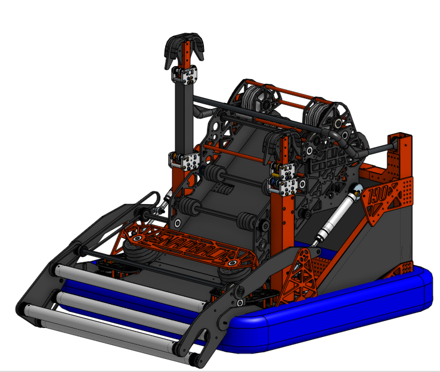
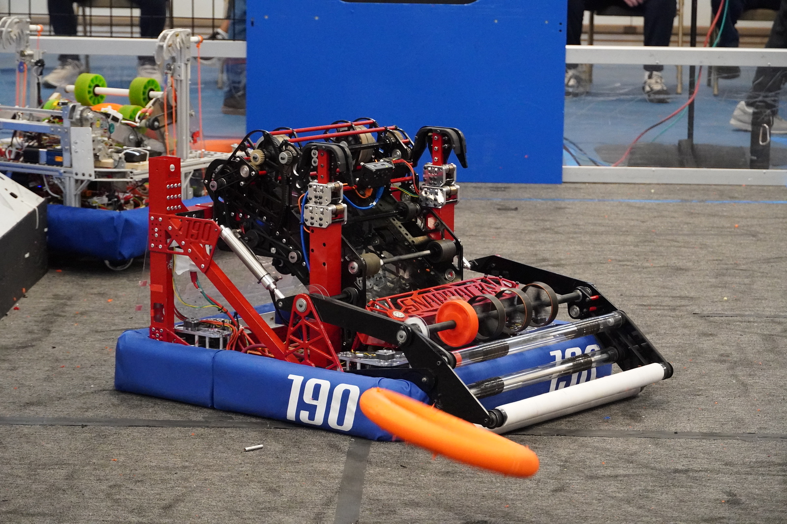
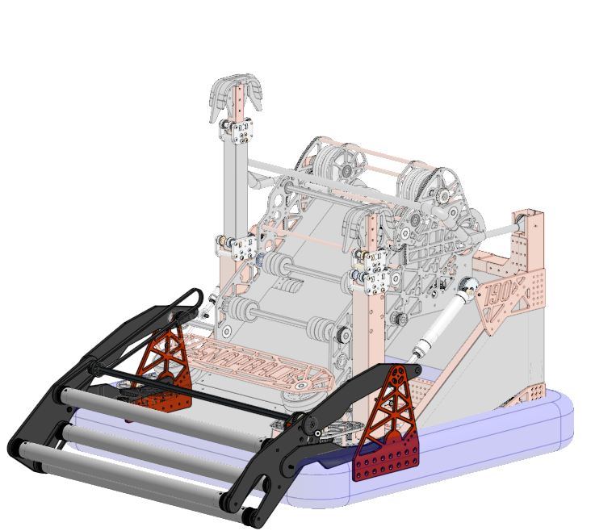

  

    <h1 class="subtitle">FRC Team 190</h1>
    
<em>2024 season</em>

    
Designed for the 2024 FRC game, "Crescendo," this robot was built to score orange rings into a goal and climb onto a chain.

    
It won its division at the world championships. My primary role was in developing the intake subsystem. The robot was originally designed in SOLIDWORKS.

    
<a href="https://www.thebluealliance.com/team/190/2024">TBA</a>

  

  

    <figure>
      
      <figcaption>Snapback robot CAD</figcaption>
    </figure>
  

  <figure>
    
    <figcaption>Snapback intaking a ring during a match</figcaption>
  </figure>
  <figure>
    
    <figcaption>Isometric CAD view of Snapback</figcaption>
  </figure>

