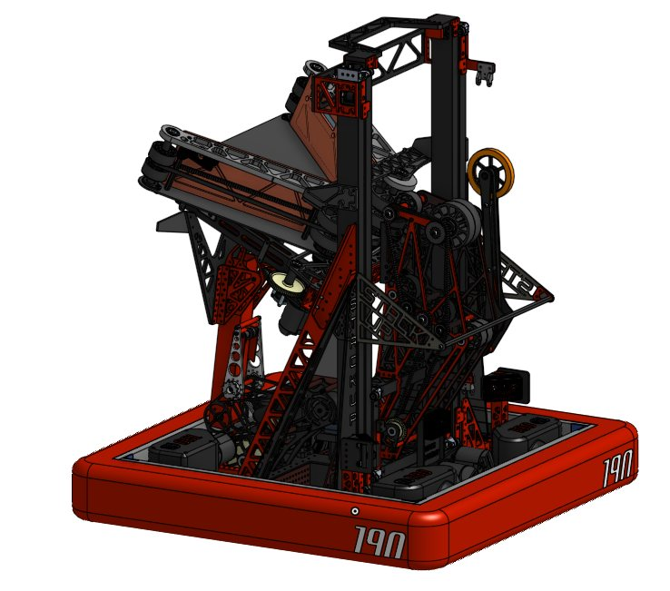
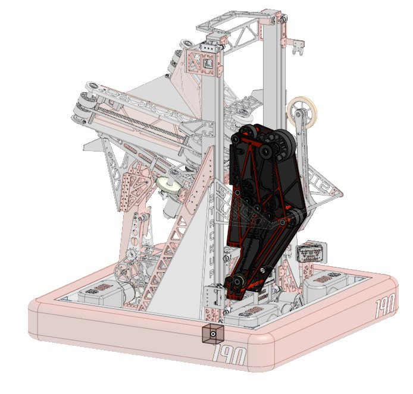
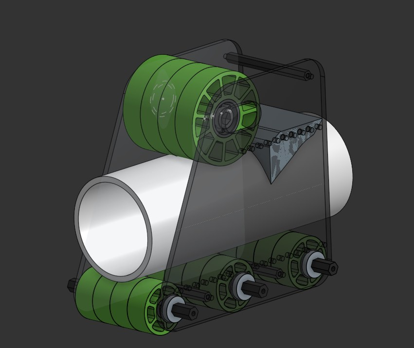
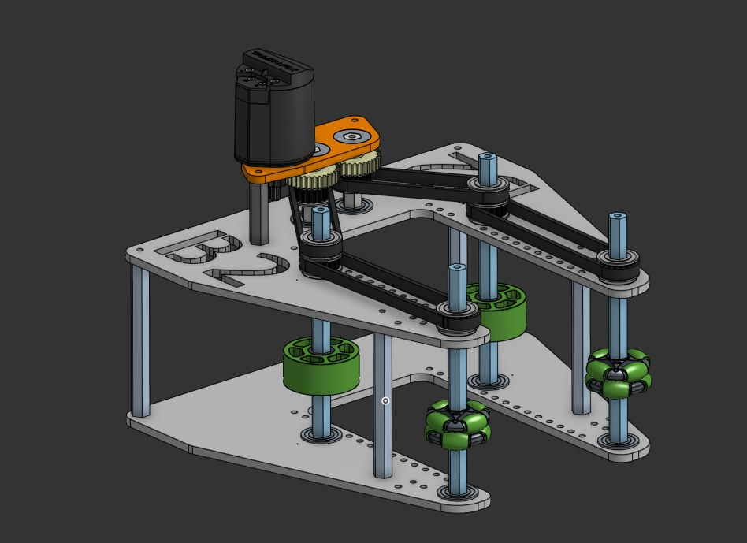
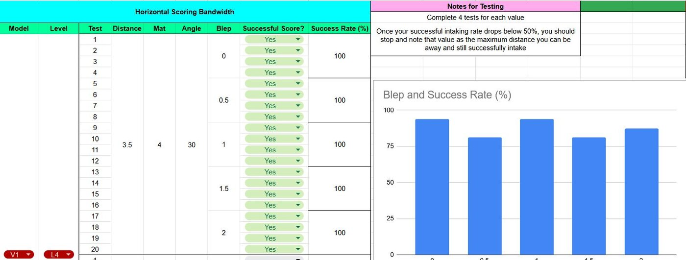
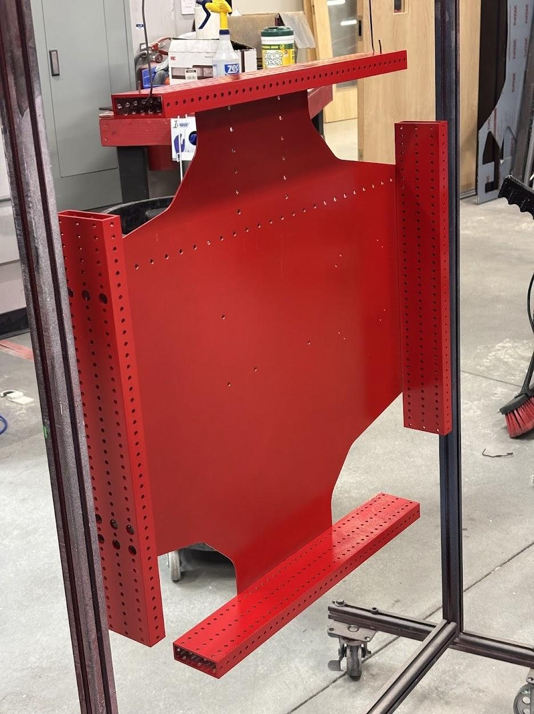
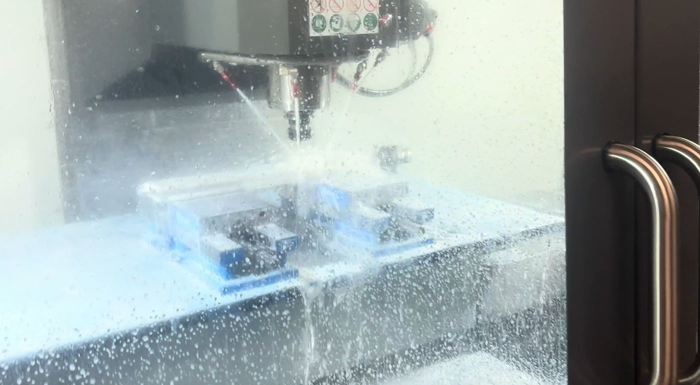

  

    <h1 class="subtitle">FRC Team 190</h1>
    
<em>2025 season</em>

    
Stackup was the first version of our robot for the 2025 FRC game, "Reefscape."

    
My role was lead mentor for the design, manufacturing, and assembly of its end effector. The second version, <a href="frcRedundancy.html">Redundancy</a>, kept a similar structure for coral and added an algae claw.

    
<a href="https://www.thebluealliance.com/team/190/2025">TBA</a>

  

  

    <figure style="--ratio:1.1336">
      
      <figcaption>Stackup CAD</figcaption>
    </figure>
  

  

    <h2 id="end-effector">End effector</h2>
    
The end effector had to manipulate coral onto the reef while keeping its weight and its degrees of freedom to a minimum.

    
The goal was to score on all four levels without adding another degree of freedom. The key was getting the coral to flip up onto the vertical L4 posts, and the position of the wheels is what let us tune that.

  

  

      <figure style="--ratio:1.0468">
        
        <figcaption>The end effector in the robot</figcaption>
      </figure>
  

  

    <h2 id="prototyping">Prototyping</h2>
    
We went through many iterations, focused on iterating quickly, and tried to learn as much as possible from each one. We recorded results so the findings were objective.

    
We built two prototypes, one with the wheels vertical and one with the wheels horizontal, which we called the X-wing. Both had movable wheels, so we could adjust the wheel position and the compression.

  

  

    

      <figure style="--ratio:1.1869">
        
        <figcaption>Prototype with vertical wheels</figcaption>
      </figure>
      <figure style="--ratio:1.3759">
        
        <figcaption>X-wing prototype, with horizontal wheels</figcaption>
      </figure>
    

    

      <figure style="--ratio:1.7778">
        <video class="loop" muted loop playsinline controls preload="none" poster="../img/frc/stackup/vertical-l4.jpg" aria-label="Vertical-wheel prototype scoring on an L4 post">
          <source src="../img/frc/stackup/vertical-l4.mp4" type="video/mp4">
        </video>
        <figcaption>Vertical-wheel prototype scoring on an L4 post</figcaption>
      </figure>
      <figure style="--ratio:0.5625">
        <video class="loop" muted loop playsinline controls preload="none" poster="../img/frc/stackup/xwing-l4.jpg" aria-label="X-wing prototype scoring on an L4 post">
          <source src="../img/frc/stackup/xwing-l4.mp4" type="video/mp4">
        </video>
        <figcaption>X-wing prototype scoring on an L4 post</figcaption>
      </figure>
    

    

      <figure style="--ratio:2.6365">
        
        <figcaption>Test log and success-rate chart</figcaption>
      </figure>
    

  

  

    <h2 id="scoring-on-l4">Scoring on L4</h2>
  

  

    

      <figure style="--ratio:0.5625">
        <video class="loop" muted loop playsinline controls preload="none" poster="../img/frc/stackup/robot-l4.jpg" aria-label="Stackup scoring on L4">
          <source src="../img/frc/stackup/robot-l4.mp4" type="video/mp4">
        </video>
        <figcaption>Stackup scoring on L4</figcaption>
      </figure>
      <figure style="--ratio:0.5625">
        <video class="loop" muted loop playsinline controls preload="none" poster="../img/frc/stackup/robot-l4-2.jpg" aria-label="Stackup scoring on L4, second view">
          <source src="../img/frc/stackup/robot-l4-2.mp4" type="video/mp4">
        </video>
        <figcaption>Stackup scoring on L4, second view</figcaption>
      </figure>
    

  

  

    <h2 id="manufacturing">Manufacturing</h2>
    
The parts were made with:

    <ul>
      <li>A Haas VF-4SS CNC mill</li>
      <li>A ShopSabre CNC router</li>
      <li>Powder coating</li>
      <li>A lathe, a mill, a bandsaw, and other shop tools</li>
      <li>3D printers</li>
    </ul>
  

  

    

      <figure style="--ratio:0.7494">
        
        <figcaption>A powder-coated part</figcaption>
      </figure>
      <figure style="--ratio:1.8182">
        
        <figcaption>Cutting on the CNC mill</figcaption>
      </figure>
    

  

  

    <h2 id="assembly">Assembly and implementation</h2>
    
Final assembly had to be organized, and we checked quality as it went together: Loctite, spacers, and accuracy.

    
Putting the end effector on the robot meant double-checking clearance, optimizing weight, and integrating it with the rest of the robot.

  

