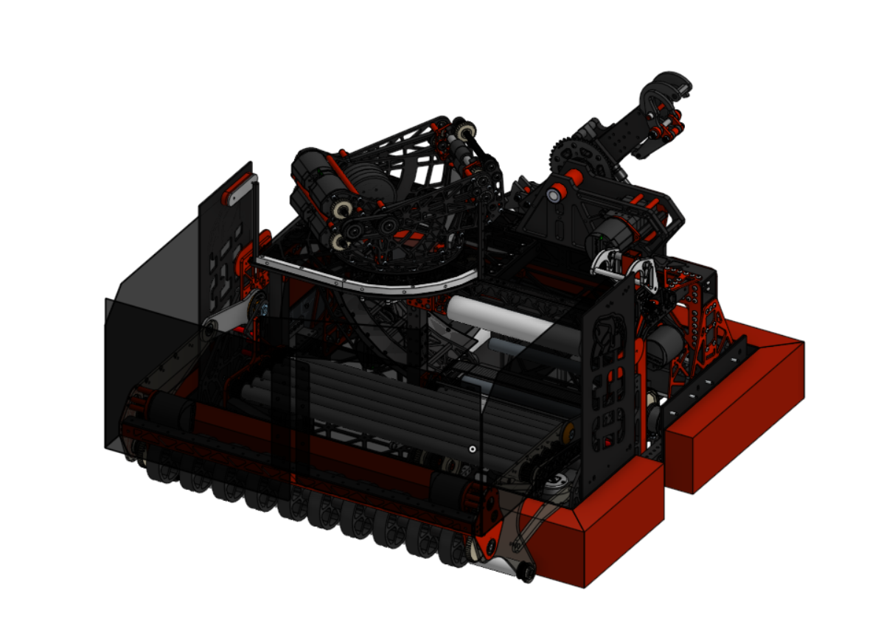
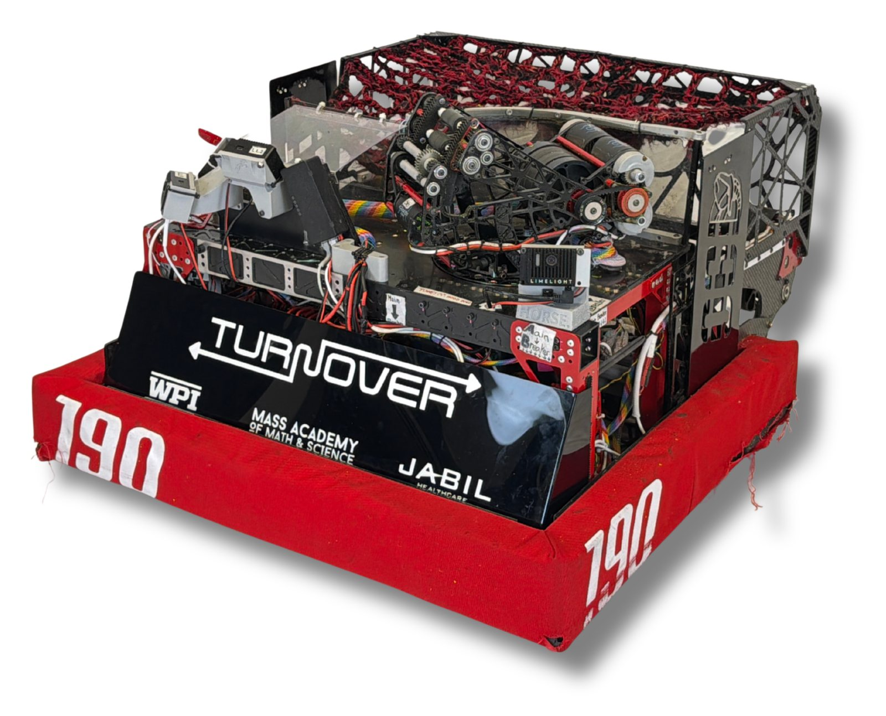
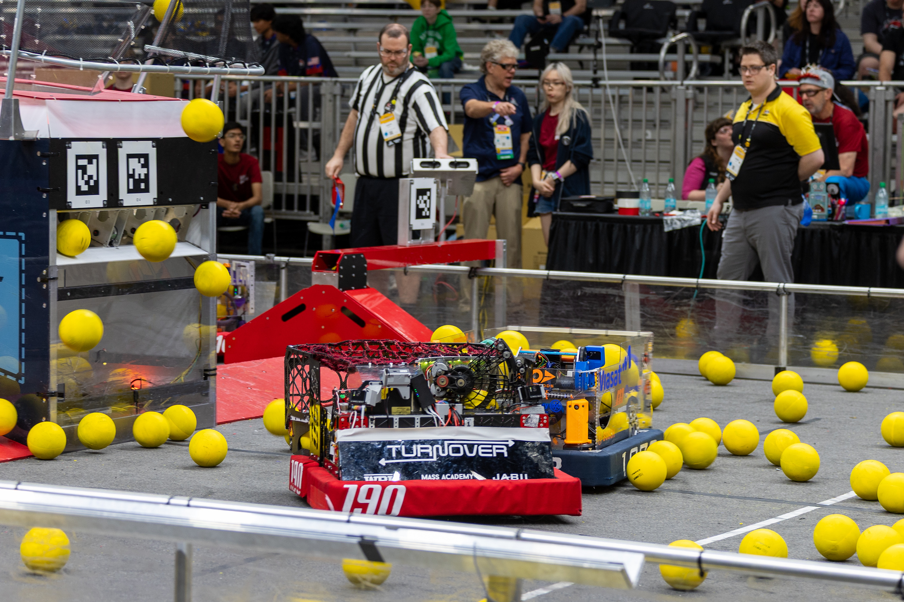
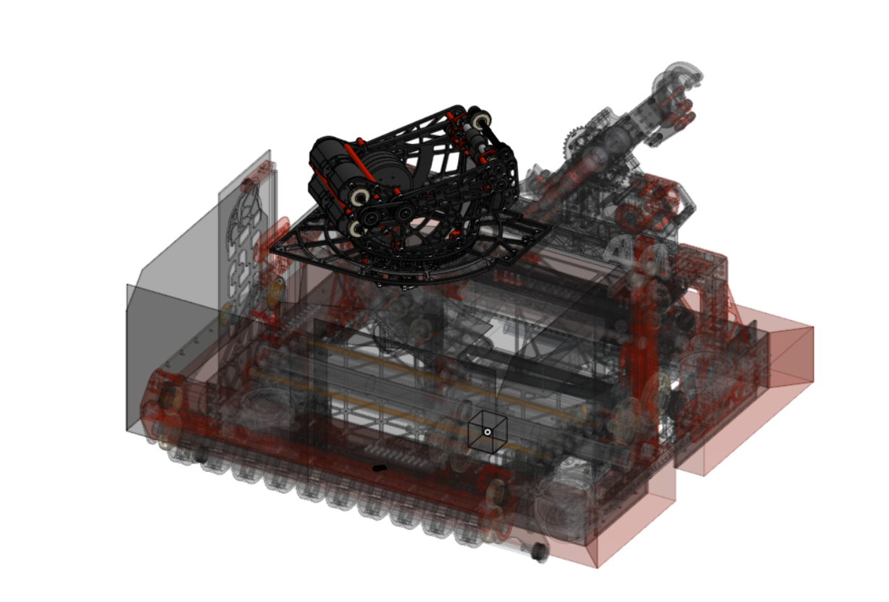
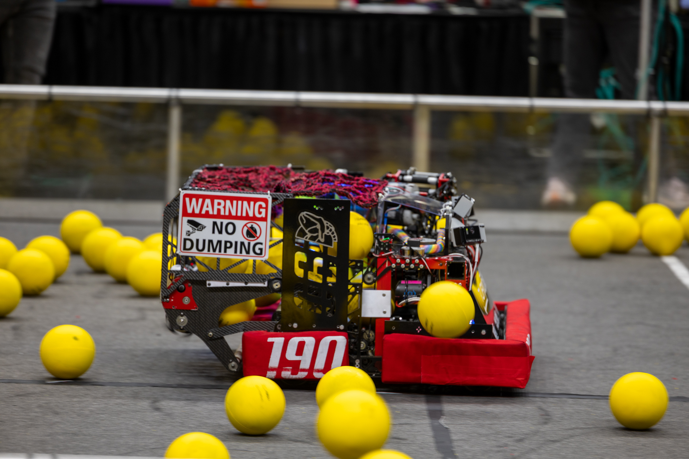

  

    <h1 class="subtitle">FRC Team 190</h1>
    
<em>2026 season</em>

    
Our second robot for the 2026 FRC game, "REBUILT."

    
Its primary goals were to shoot yellow foam "Fuel" balls into an alliance Hub that alternates between active and inactive over the course of the match, and to climb the rungs of a ladder-shaped Tower in the endgame. My main contributions were to the turret and shooter subsystem. The robot was originally designed in Onshape.

    

      <a href="https://frc190.onshape.com/documents/ba8a365713d40fc24cf0b54f/w/d6e4ee38f39fcc9a54144a27/e/f7562994bcc6d5175e8e4e30?configuration=default&renderMode=0&uiState=6a18f291fa835462eeaa4a52">CAD</a>
      &middot;
      <a href="https://www.thebluealliance.com/team/190/2026">TBA</a>
    

  

  

    <figure>
      
      <figcaption>Turnover full robot CAD</figcaption>
    </figure>
  

  <figure>
    
    <figcaption>Turnover photoshoot image</figcaption>
  </figure>
  <figure>
    
    <figcaption>Turnover shooting during a match</figcaption>
  </figure>
  <figure>
    
    <figcaption>Isometric CAD view of the Turnover turret and shooter assembly</figcaption>
  </figure>
  <figure>
    
    <figcaption>Turnover driving during a match</figcaption>
  </figure>

