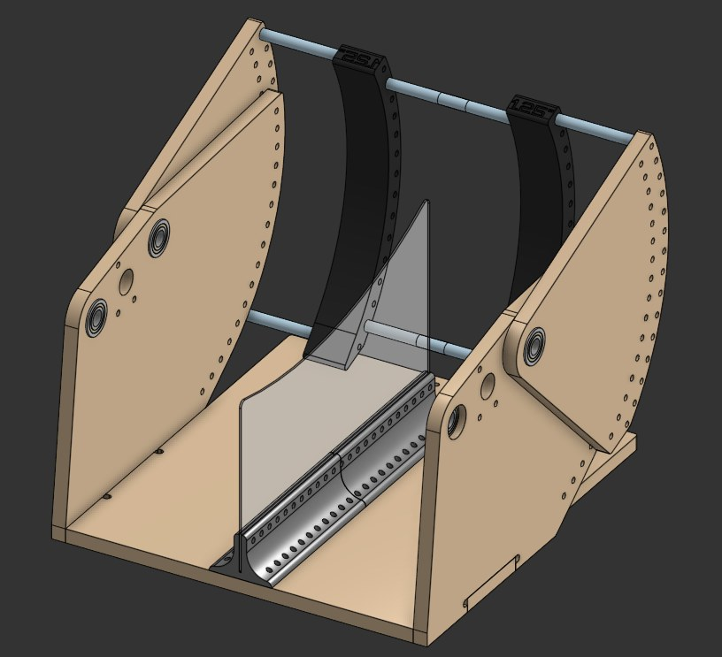
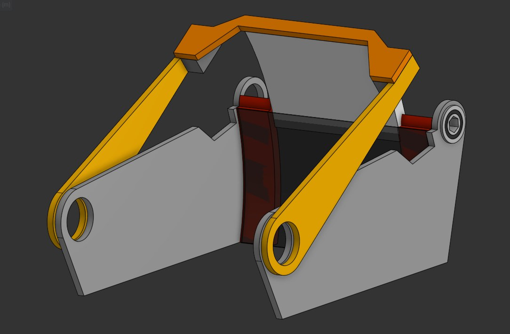
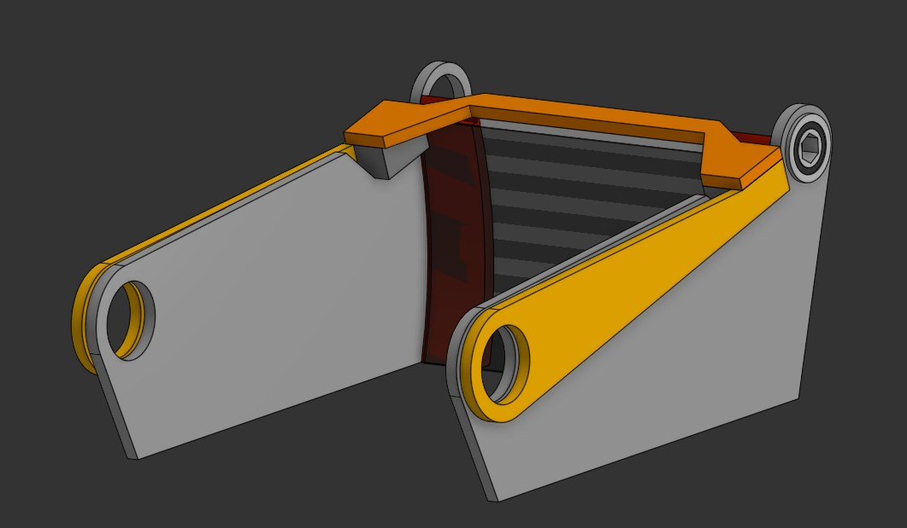

  

    <h1 class="subtitle">FRC Team 190</h1>
    
<em>2026 season</em>

    
Our second robot for the 2026 FRC game, "REBUILT."

    
Its primary goals were to shoot yellow foam "Fuel" balls into an alliance Hub that alternates between active and inactive over the course of the match, and to climb the rungs of a ladder-shaped Tower in the endgame. My main contributions were to the turret and shooter subsystem. The robot was originally designed in Onshape.

    

      <a href="https://frc190.onshape.com/documents/ba8a365713d40fc24cf0b54f/w/d6e4ee38f39fcc9a54144a27/e/f7562994bcc6d5175e8e4e30?configuration=default&renderMode=0&uiState=6a18f291fa835462eeaa4a52">CAD</a>
      &middot;
      <a href="https://www.thebluealliance.com/team/190/2026">TBA</a>
    

  

  

    <figure>
      
      <figcaption>Turnover full robot CAD</figcaption>
    </figure>
  

  <figure>
    
    <figcaption>Turnover photoshoot image</figcaption>
  </figure>
  <figure>
    
    <figcaption>Turnover shooting during a match</figcaption>
  </figure>
  <figure>
    
    <figcaption>Isometric CAD view of the Turnover turret and shooter assembly</figcaption>
  </figure>
  <figure>
    
    <figcaption>Turnover driving during a match</figcaption>
  </figure>

  

    <h2>Prototyping the shooter</h2>
    
Before settling on the V1 shooter, we tested it on prototypes. Prototype 1 was built before the season started. The custom prototype is the one we made ourselves, described below.

  

  

    <figure>
      <video class="loop" muted loop playsinline controls preload="none" style="--ratio:1.7778" poster="../img/frc/turnover/prototype-1.jpg" aria-label="Prototype 1, built before the season started">
        <source src="../img/frc/turnover/prototype-1.mp4" type="video/mp4">
      </video>
      <figcaption>Prototype 1, built before the season started</figcaption>
    </figure>
    <figure>
      <video class="loop" muted loop playsinline controls preload="none" style="--ratio:1.7778" poster="../img/frc/turnover/mass-prototype-1.jpg" aria-label="Mass prototype 1">
        <source src="../img/frc/turnover/mass-prototype-1.mp4" type="video/mp4">
      </video>
      <figcaption>Mass prototype 1</figcaption>
    </figure>
  

  

    <h2>Custom prototype</h2>
    
The custom prototype had three adjustments:

    <ul>
      <li>An adjustable hood angle</li>
      <li>An optional divider</li>
      <li>Adjustable compression, set by changing the back piece</li>
    </ul>
    
It was built mainly from CNC-cut plywood and 3D printed parts so we could iterate quickly. We used it to inform the amount of compression and the hood angle the real version needed.

  

  

    <figure>
      
      <figcaption>Custom prototype CAD, with the divider</figcaption>
    </figure>
    <figure>
      
      <figcaption>Custom prototype CAD, without the divider</figcaption>
    </figure>
    <figure>
      <video class="loop" muted loop playsinline controls preload="none" style="--ratio:1.7778" poster="../img/frc/turnover/custom-prototype-1.jpg" aria-label="Custom prototype shooting">
        <source src="../img/frc/turnover/custom-prototype-1.mp4" type="video/mp4">
      </video>
      <figcaption>Custom prototype shooting</figcaption>
    </figure>
    <figure>
      <video class="loop" muted loop playsinline controls preload="none" style="--ratio:1.7778" poster="../img/frc/turnover/custom-prototype-2.jpg" aria-label="Custom prototype shooting, wider view">
        <source src="../img/frc/turnover/custom-prototype-2.mp4" type="video/mp4">
      </video>
      <figcaption>Custom prototype shooting, wider view</figcaption>
    </figure>
  

  

    <h2>Early hood concept</h2>
    
An early concept for the hood, shown in cartoon-style CAD.

  

  

    <figure>
      
      <figcaption>Early hood concept</figcaption>
    </figure>
    <figure>
      
      <figcaption>Early hood concept, second view</figcaption>
    </figure>
  

  

    <h2>The real shooter</h2>
    
The finished V1 shooter running on Turnover, built with the compression and hood angle worked out on the prototype.

  

  

    <figure>
      <video class="loop" muted loop playsinline controls preload="none" style="--ratio:1.7778" poster="../img/frc/turnover/real-shooter.jpg" aria-label="Turnover shooting">
        <source src="../img/frc/turnover/real-shooter.mp4" type="video/mp4">
      </video>
      <figcaption>Turnover shooting</figcaption>
    </figure>
  

