

  

    <h1 class="subtitle">WPI Formula SAE</h1>
    
<em>2026-2027 season</em>

    
Formula SAE is an intercollegiate competition where student teams design, build, and race a formula-style car. WPI's team runs a full season, from concept through fabrication to competition.

    
I am working on design and manufacturing this year. Most of my work has been on the pedal box for EV27, Goat Fast Racing's new car, and in particular the pedal slide: the rails, carriage, and mounts that let the pedals move to fit each driver.

  

  

    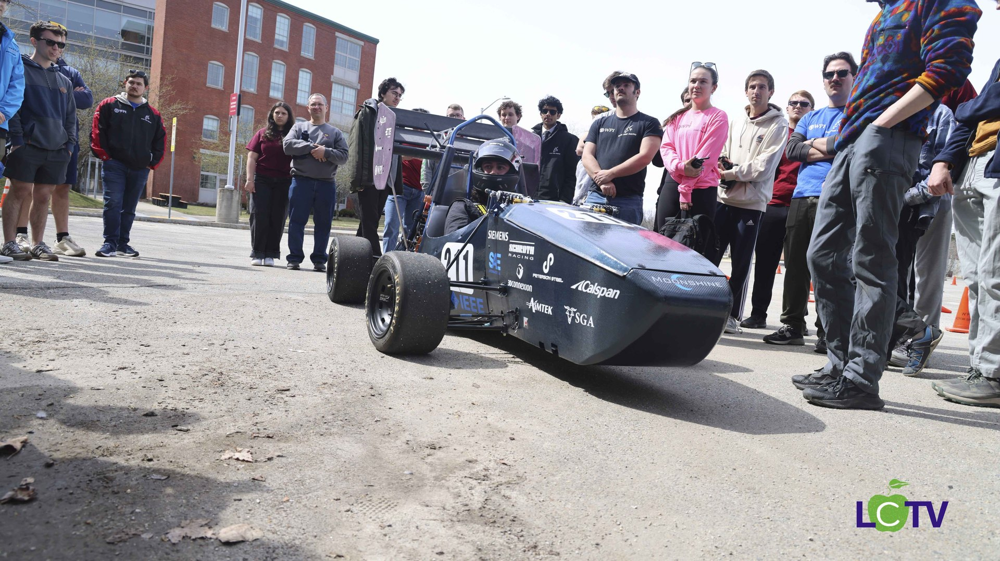
    <figure>
      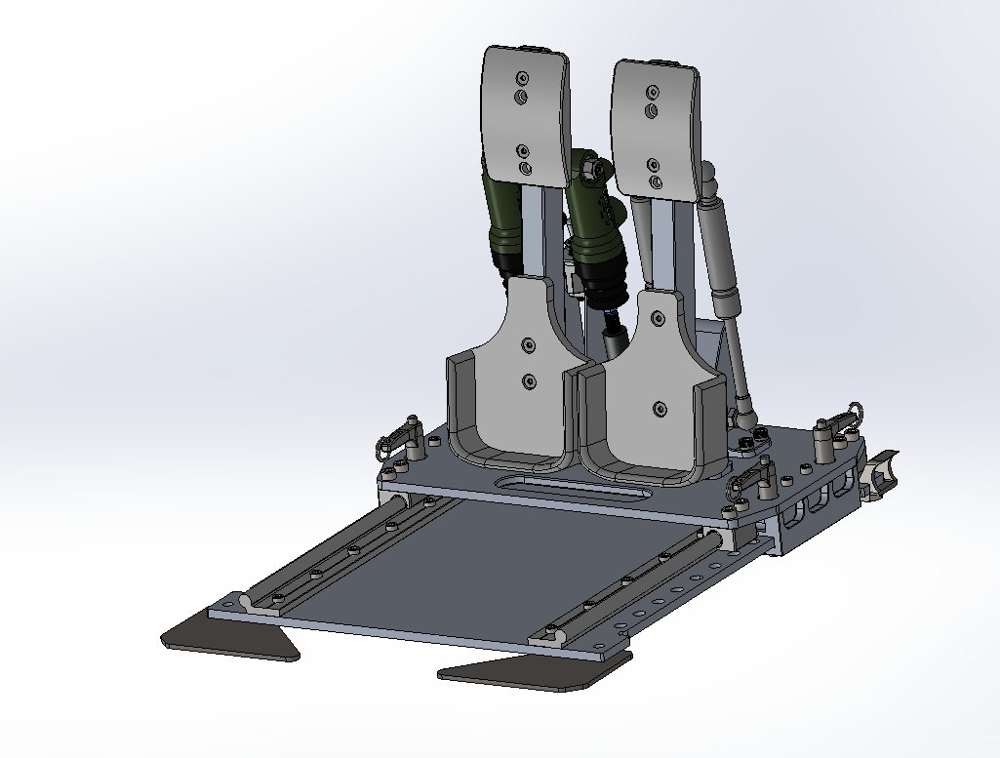
      <figcaption>The EV27 pedal box</figcaption>
    </figure>
  

  

    <h2>Redesigning the pedal box</h2>
    
The pedal box is how the driver brakes and accelerates. The accelerator and brake pedals are worked by the right and left foot. Sensors at the accelerator's pivot record its position, and the brake pedal's motion is amplified by the master cylinders, which push fluid through the brake lines to the front and rear brakes. All of it sits on a platform that moves toward or away from the driver to fit different heights.

    
The previous car, Moonshine, had its pedal box designed in 2024 and updated in 2025. Its adjustment mechanism was prone to binding, and the pedals and baseplate were bulkier than they needed to be. Those problems, plus EV27's narrower chassis, made this the first chance in several years to redesign the whole thing.

  

  

    <figure>
      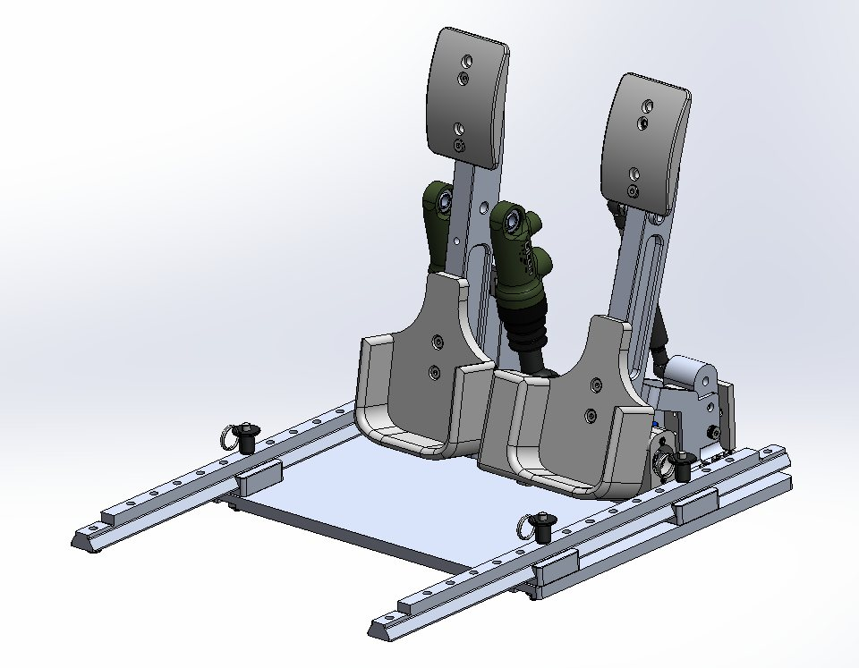
      <figcaption>Moonshine's pedal box</figcaption>
    </figure>
  

<h2>Choosing a design</h2>

I started by collecting the rules that apply, from the FSAE and Formula Hybrid + Electric 2027 rule sets, and adding requirements of our own. These shaped the design the most:

<table class="spec">
  <thead>
    <tr><th>Requirement</th><th>Target</th></tr>
  </thead>
  <tbody>
    <tr><td>Carry the brake pedal load without failure of the brake system, pedal box, chassis mounting, or pedal adjustment</td><td class="num">2,000 N (FSAE T.3.2.2)</td></tr>
    <tr><td>Fit drivers from a 5th-percentile female to a 95th-percentile male</td><td class="num">200 mm of travel, 25 mm per notch</td></tr>
    <tr><td>Lock positively at every adjustment position</td><td>Team requirement</td></tr>
    <tr><td>Adjust with one person and no tools</td><td class="num">Under 30 s</td></tr>
    <tr><td>Hard stops at both ends of the rail travel, to prevent derailment</td><td>Team requirement</td></tr>
    <tr><td>Room on the carriage for the pedal sensors and a waterproof pedal board</td><td>Team requirement</td></tr>
    <tr><td>Treat every brake fastener as critical</td><td>Grade 5, 8.8, or AN, with positive locking</td></tr>
  </tbody>
</table>

From there I researched ten potential archetypes, including the dovetail rail design on Moonshine. I ruled out a lathe-tailstock-style clamp, a lead screw, and independent left and right pedals because of complexity, packaging, or the lack of a positive lock. The design I picked is close to the existing one, with a few key changes.

  

    <h2>How the slide works</h2>
    
Four steel tabs are welded to the chassis tubes, and a carrier plate bolts to the tabs. Two igus WS-10 rails mount to the carrier plate, and four stainless steel pillow blocks ride on them. The pedal assembly bolts to a carriage plate on top of the pillow blocks.

    
The carrier plate is the biggest change from Moonshine. It lets the pedal box be assembled and checked for binding outside the car, it keeps the pin holes out of the rails, and it means the rails don't depend on precisely placed tabs.

    
The fore tabs are 1 x 1 inch steel box tube with 1/8-inch walls, and the aft tabs are 1/8-inch steel plate. The carrier and carriage plates are 1/4-inch 6061-T6 aluminum, and the rails mount to the carrier plate with eight #10-32 bolts and nylock nuts.

  

  

    <figure>
      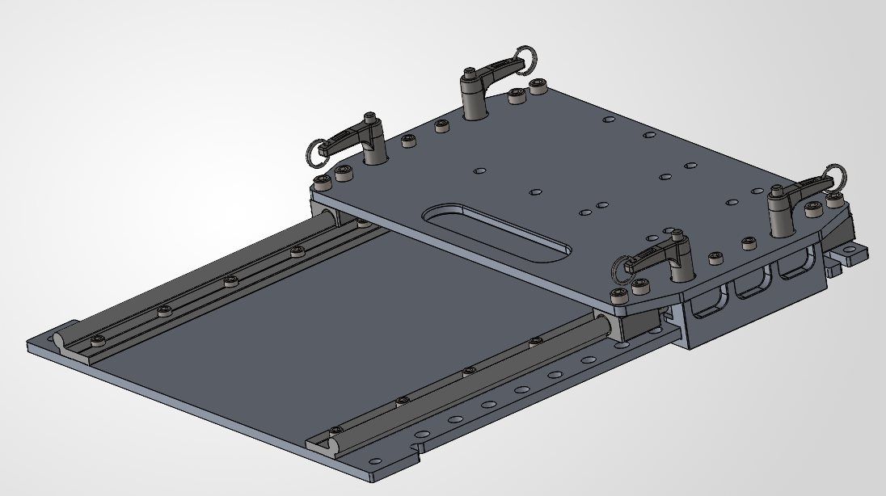
      <figcaption>The pedal slide</figcaption>
    </figure>
    <figure>
      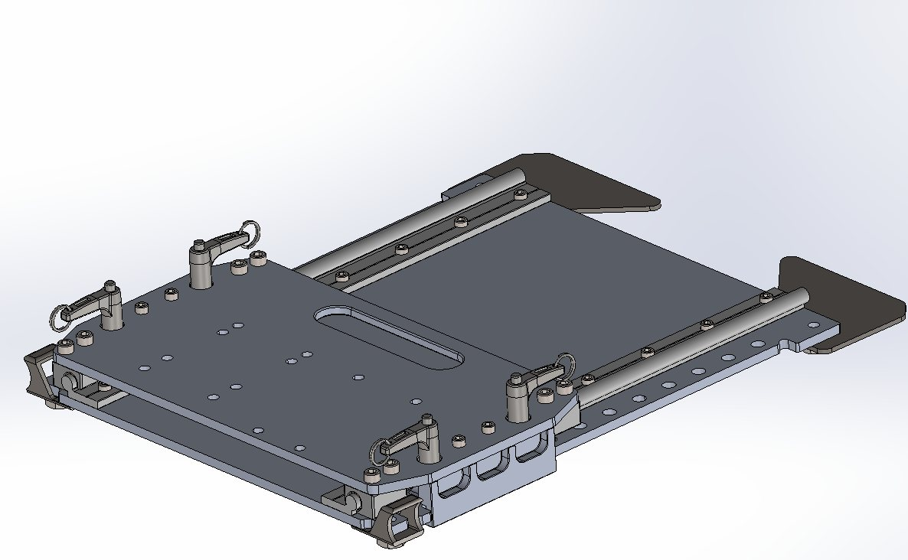
      <figcaption>The slide with its carrier plate and tabs</figcaption>
    </figure>
  

  

    <h2>Carriage and pins</h2>
    
The carriage is the carriage plate, two pin blocks, and the four pillow blocks, with the pedal assembly mounted on top. A slot in the carriage plate works as a handle for pushing it along the rails.

    
The pin blocks sit on either side of the carriage and reach around the carrier plate, which puts each pin in double shear and makes it less likely to bind. The pins are 5/16-inch L-handle quick-release pins, thicker than Moonshine's and oversized for the job so they last, and the pin blocks are machined from 6061-T6 aluminum billet.

  

  

    <figure>
      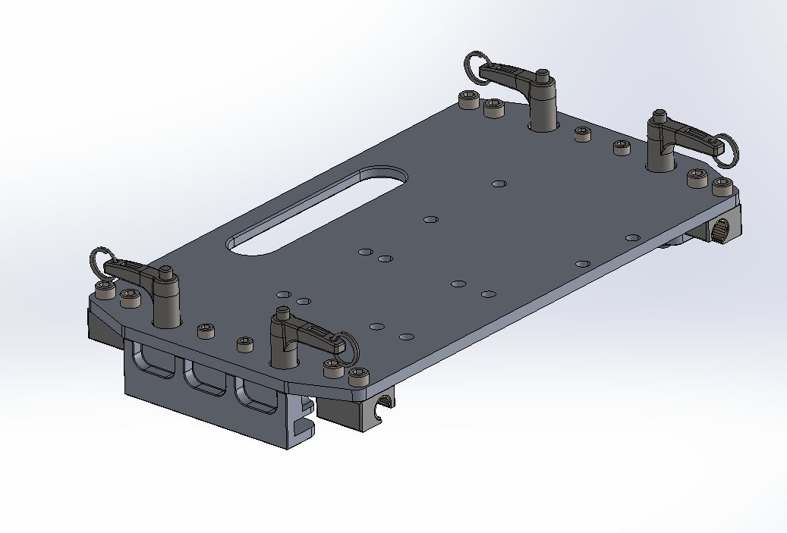
      <figcaption>Carriage assembly</figcaption>
    </figure>
    <figure>
      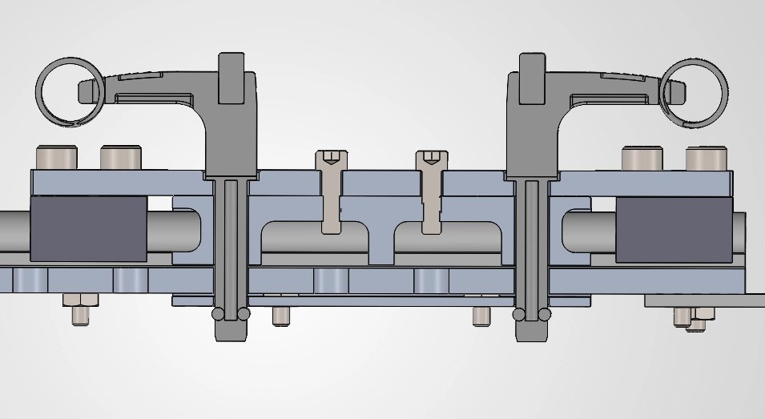
      <figcaption>Section through the pin blocks</figcaption>
    </figure>
  

  

    <h2>Working with igus</h2>
    
One key change from Moonshine was moving from custom rails to igus rails. We set up a meeting with igus over email, and they sent a free set of rail samples to test. I checked the samples on the mill with an indicator, and they were straight to within about 0.004 inch.

    
The pillow blocks run on self-lubricating polymer liners, so the slide needs no grease and doesn't pick up dirt and debris from drivers' shoes. The liners also tolerate small misalignments and contamination that would make a ball bearing carriage bind or skip, which keeps the adjustment smooth. The rails are hard anodized aluminum to keep the weight down, and the pillow blocks are stainless steel so they resist corrosion in the wet.

    
Being off the shelf, the system comes with published load ratings: 3,800 N in lift-off and compression, and lower ratings in the Coz&minus; direction. igus sponsored the rails and pillow blocks, which cut the cost of the slide by about $228.

  

  

    <figure>
      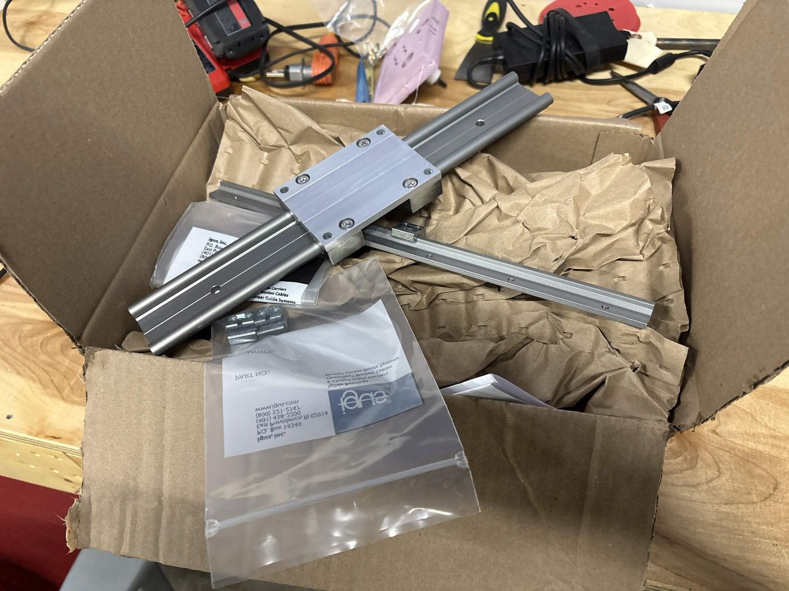
      <figcaption>Samples from igus</figcaption>
    </figure>
    <figure>
      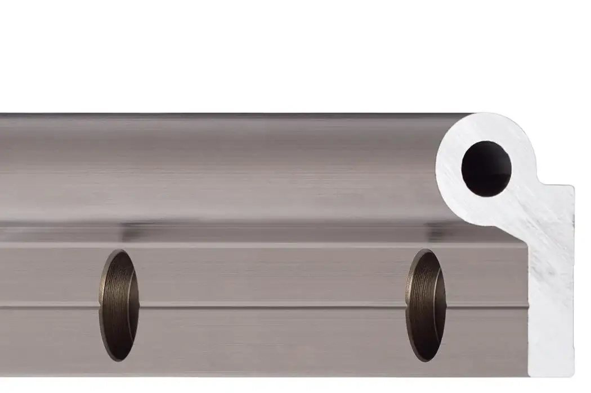
      <figcaption>drylin W single rail, WS-10</figcaption>
    </figure>
  

  

    <h2>Checking the design</h2>
    
I checked the slide against the 2,000 N brake pedal load, with hand calculations first and then FEA. The hand calculations covered the igus pillow blocks in the worst case, which is yaw on the carriage from pushing on either pedal:

    <table class="spec">
      <thead>
        <tr><th>Load case</th><th>Rated</th><th>Experienced</th><th>Factor of safety</th></tr>
      </thead>
      <tbody>
        <tr><td>Lift-off / compression</td><td class="num">3,800 N</td><td class="num">1,883.6 N</td><td class="num">2.0</td></tr>
        <tr><td>Block side load, Coz+</td><td class="num">3,800 N</td><td class="num">1,280.8 N</td><td class="num">3.0</td></tr>
        <tr><td>Block side load, Coz&minus;</td><td class="num">950 N</td><td class="num">1,280.8 N</td><td class="num low">0.7</td></tr>
        <tr><td>Pin shear</td><td class="num">64,000 N</td><td class="num">2,000 N</td><td class="num">32.0</td></tr>
      </tbody>
    </table>
    
The lowest number is the side load on the pillow blocks in the Coz&minus; direction, at 0.7. That is acceptable because the calculation assumes the pins take none of the load, and only two of the blocks are loaded in that weaker direction.

    
I also compared igus rail sizes by their deflection under 1,000 N per rail. Held by the carrier plate, a 50 mm span, a WS-10 rail has a top-to-bottom factor of safety of 152. Across the 450 mm between the tabs it would be 0.21. With the rails tied to the carrier plate, the strength rating of the pillow blocks is what sets the size, which is why we went with the heavy-duty stainless steel pillow blocks.

    
FEA covered the five custom parts. Each study fixed the holes or tube ends that tie a part to the next one and loaded the holes that carry the force, and the tab models include a 3 mm fillet weld to the chassis tube. Every part clears yield, and the lowest factor of safety is 2.0, on the fore tabs.

    <table class="spec">
      <thead>
        <tr><th>Part</th><th>Load</th><th>Max displacement</th><th>Min. factor of safety</th></tr>
      </thead>
      <tbody>
        <tr><td>Carriage plate</td><td class="num">4,000 N</td><td class="num">0.01 mm</td><td class="num">11</td></tr>
        <tr><td>Pin block</td><td class="num">2 x 2,000 N</td><td class="num">0.008 mm</td><td class="num">8.8</td></tr>
        <tr><td>Carrier plate</td><td class="num">2,000 N</td><td class="num">0.2 mm</td><td class="num">3.8</td></tr>
        <tr><td>Fore tab</td><td class="num">2,000 N</td><td class="num">0.05 mm</td><td class="num">2.0</td></tr>
        <tr><td>Aft tab</td><td class="num">2,000 N</td><td class="num">0.02 mm</td><td class="num">3.8</td></tr>
      </tbody>
    </table>
  

  

    

      <figure>
        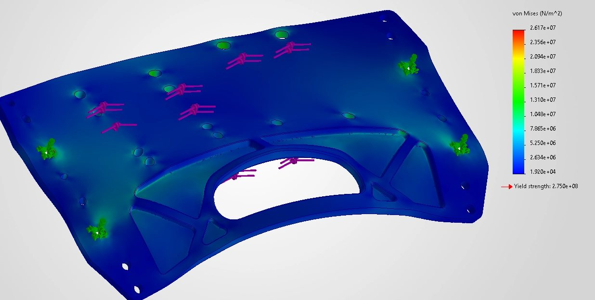
        <figcaption>Carriage plate: minimum factor of safety 11</figcaption>
      </figure>
      <figure>
        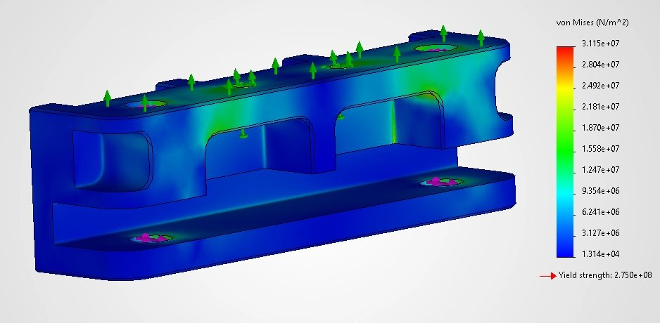
        <figcaption>Pin block: 8.8</figcaption>
      </figure>
      <figure>
        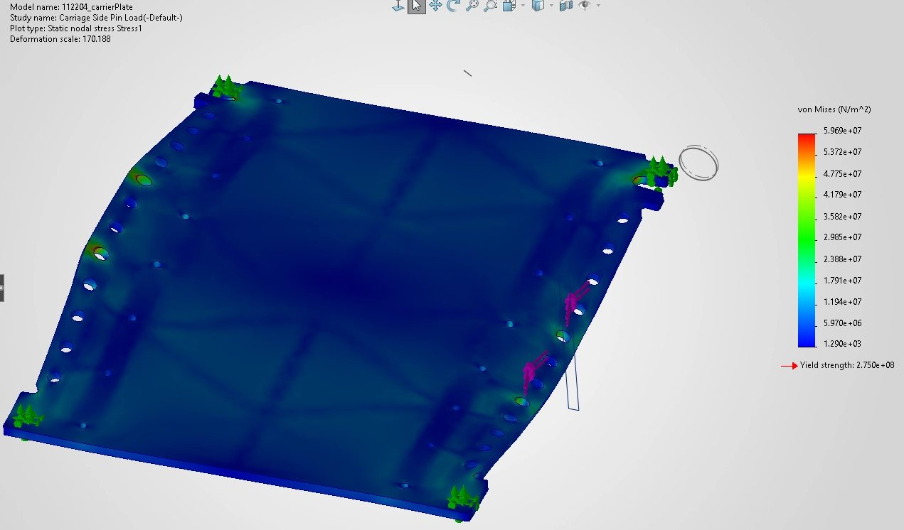
        <figcaption>Carrier plate: 3.8</figcaption>
      </figure>
      <figure>
        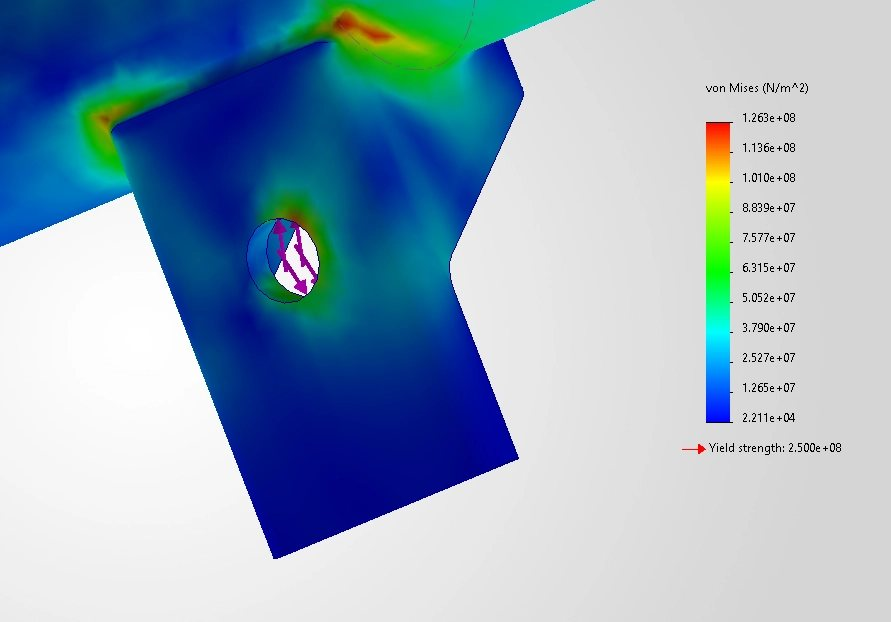
        <figcaption>Fore tab: 2.0</figcaption>
      </figure>
      <figure>
        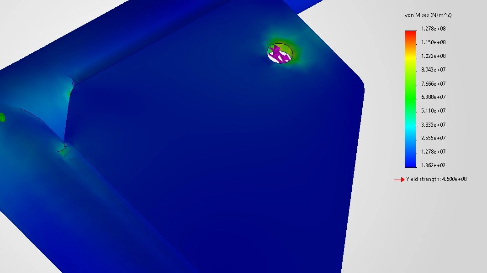
        <figcaption>Aft tab: 3.8</figcaption>
      </figure>
    

  

<h2>The rest of the pedal box</h2>

Around the slide, the team worked out the pedals and brake hardware. Moonshine's drivers liked the gas pedal but wanted a stiffer brake pedal, so EV27's brake pedal ratio dropped from 4.3 to 4.04. The rules require two springs on the accelerator where Moonshine had one gas strut, so the accelerator ratio went from 2.32 to 4.61 to keep the same feel.

Tilton 78-series master cylinders (7/10-inch front, 15/16-inch rear) and a Tilton 900-series balance bar, with ISR calipers, are sized to hit a 65% brake bias. The pedal footprint came down by 0.33 inch so that a 95th-percentile male still fits behind EV27's shorter nose. FEA at 2,000 N gave minimum factors of safety of 5.42 on the brake pedal, 4.2 on the accelerator pedal, and 3.9 on the accelerator hard stop.

The result is a compact, lightweight pedal box that meets the rules and is easy to adjust. Manufacturing starts in B-term.

