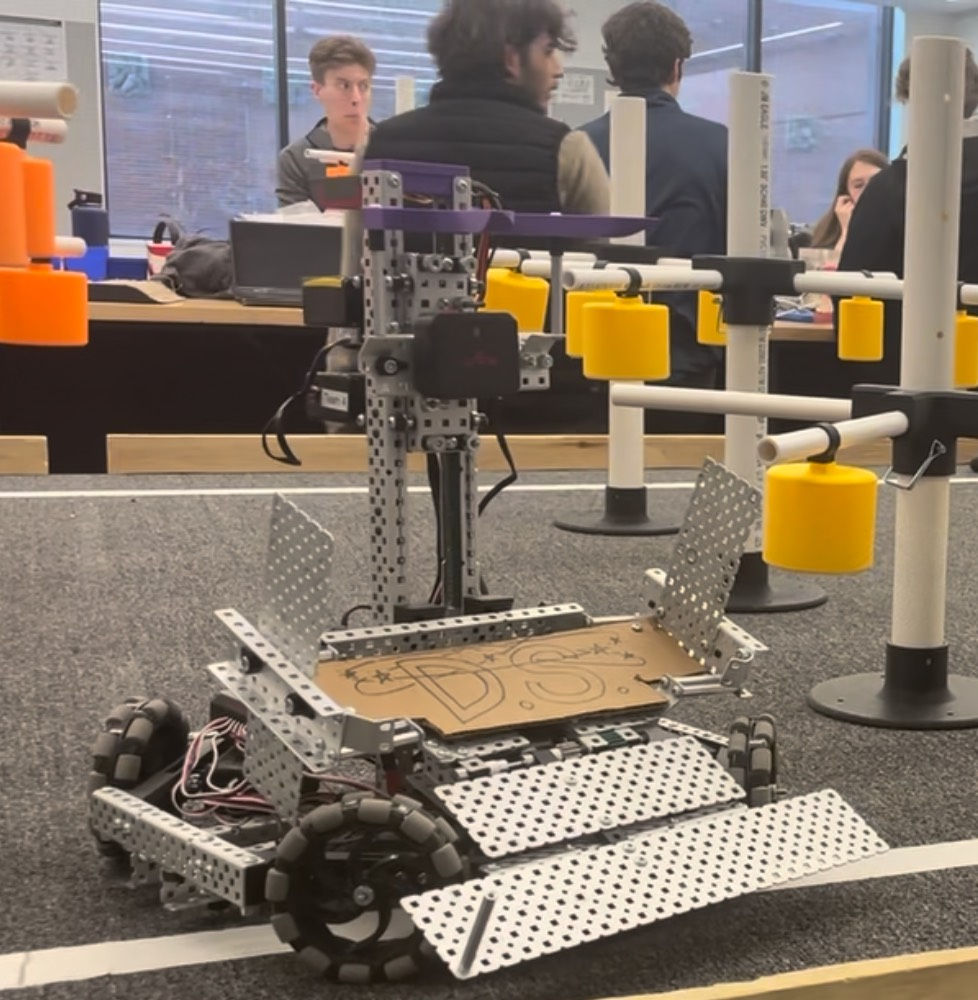

  

    
This is a vex robot that my team and I built for our RBE1001 class. It was able to autonomously navigate the &lsquo;Orchard&rsquo; and collect &lsquo;fruit&rsquo;. Some aspects of this project included:

    <ul>
      <li>Designing and 3D printing custom parts</li>
      <li>Working with different sensors such as encoders, distance sensors, line sensors, and cameras</li>
      <li>Creating a state machine to automatically navigate</li>
    </ul>
    
<a href="../img/classes/Group_4_Final_Proposal-1.pdf">Read the Full Report</a>

  

  

    
  

  

    <h2>X drive</h2>
    
The robot used an X drive, which let it translate holonomically: it could move in any direction, including straight sideways, without turning first.

  

  

    <figure style="--ratio:1.7778">
      <video class="loop" muted loop playsinline controls preload="none" poster="../img/classes/rbe1001/x-drive.jpg" aria-label="The X drive translating holonomically">
        <source src="../img/classes/rbe1001/x-drive.mp4" type="video/mp4">
      </video>
      <figcaption>The X drive translating holonomically</figcaption>
    </figure>
  

  

    <h2>Picking fruit</h2>
    
Using a camera, the robot could find and pick fruit autonomously. It could also be driven by hand (teleop).

  

  

    

      <figure style="--ratio:1.7778">
        <video class="loop" muted loop playsinline controls preload="none" poster="../img/classes/rbe1001/autonomous-fruit-collection.jpg" aria-label="Collecting fruit autonomously, using the camera">
          <source src="../img/classes/rbe1001/autonomous-fruit-collection.mp4" type="video/mp4">
        </video>
        <figcaption>Collecting fruit autonomously, using the camera</figcaption>
      </figure>
      <figure style="--ratio:1.7778">
        <video class="loop" muted loop playsinline controls preload="none" poster="../img/classes/rbe1001/teleop-fruit-collection.jpg" aria-label="Collecting fruit under driver control (teleop)">
          <source src="../img/classes/rbe1001/teleop-fruit-collection.mp4" type="video/mp4">
        </video>
        <figcaption>Collecting fruit under driver control (teleop)</figcaption>
      </figure>
    

  

